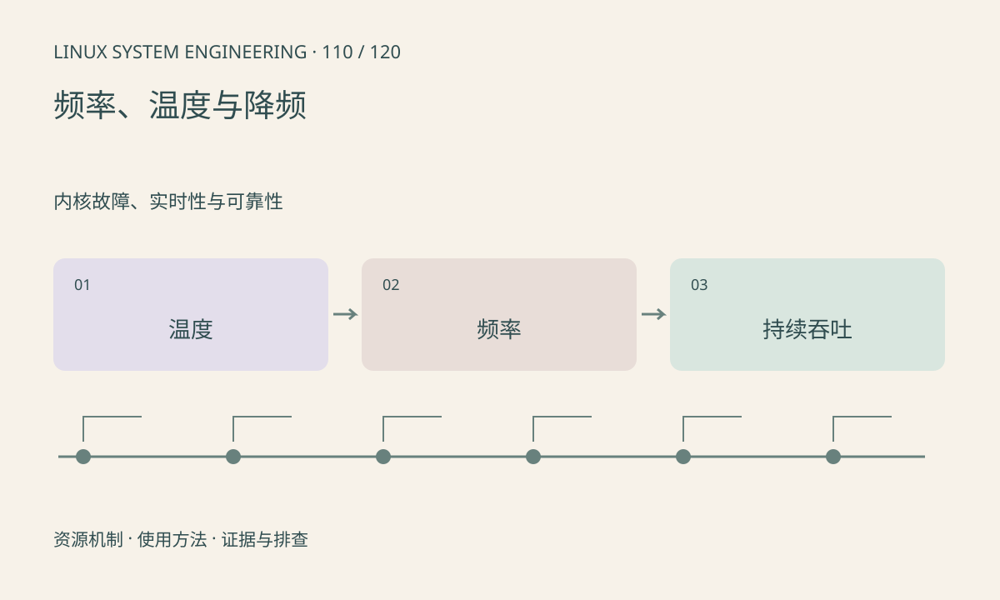

> 第 110 / 120 课 · 内核故障、实时性与可靠性。返回[课程合集](/series/embedded-linux-system-engineering/)。

## 机制与资源关系

CPU 和设备频率由策略、负载、温度及电源条件共同控制。NPU/GPU 可能走 devfreq 或厂商接口，CPU 频率不代表全 SoC。温度升高导致吞吐下降时，需把时序关联起来。



## 实际用法与观察入口

以下是操作说明；先确认执行环境、工具帮助和目标对象。设备名、PID、地址及项目名示例需要按实际替换，不能将整段命令当通用板端脚本执行。

```sh
ls /sys/devices/system/cpu/cpufreq
ls /sys/class/devfreq
ls /sys/class/thermal
# 查看具体节点前先读 type 确认传感器
```

## 输出解读与排查顺序

记录传感器类型、单位、频率和业务负载。某些频率属性是请求值或估计值，不能一概当实测。不要关闭热保护来验证性能；应改善散热或工作负载设计。

### 情境推演

推理刚启动 30fps、十分钟后 20fps，同时温度升高且设备频率下降，这是热限制线索。还需固定模型和负载并重复验证，不能只看到温度高就下结论。

## 练习与参考分析

设计冷启动与热稳态的同输入测试。参考结论：只报告前一分钟的峰值帧率可能遗漏持续运行时的降频，产品应给出条件和稳态结果。

本课练习属于阅读、分析或板端观察。未在目标开发板执行，记录时应写明板型、内核配置、工具版本和原始输出。

## 官方资料与版本边界

- [本课参考资料](https://docs.kernel.org/admin-guide/pm/cpufreq.html)

内核、工具和厂商 BSP 的支持范围需分别核对。参考资料可能对应较新版本；不要据此推定旧 BSP 支持所有接口。

[上一课：时钟源、时间戳与对齐](/posts/linux-sys-109.html) · [下一课：suspend、runtime PM 与唤醒](/posts/linux-sys-111.html)
