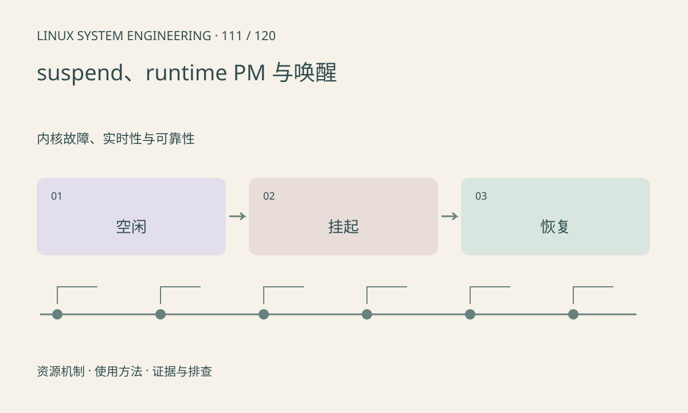

> 第 111 / 120 课 · 内核故障、实时性与可靠性。返回[课程合集](/series/embedded-linux-system-engineering/)。

## 机制与资源关系

系统休眠面向整机，runtime PM 管理运行期间的单设备空闲。设备访问需要持有相应运行条件，唤醒源和父子设备关系影响恢复顺序。功耗优化可能暴露原先隐藏的竞态。



## 实际用法与观察入口

以下是操作说明；先确认执行环境、工具帮助和目标对象。设备名、PID、地址及项目名示例需要按实际替换，不能将整段命令当通用板端脚本执行。

```sh
cat /sys/power/state
cat /sys/power/mem_sleep
# 在具体设备目录下只读查看 power 属性
ls /sys/bus/platform/devices
```

## 输出解读与排查顺序

先确认首次访问、空闲后访问和恢复后访问的差异。读写 power/control 会改变策略，本文不自动操作。DMA 未停就撤电可能造成总线错误和数据破坏。

### 情境推演

第一次取流正常、停止再启动失败，可能是 runtime suspend 后资源未恢复。记录 power 状态和驱动日志，检查恢复顺序，而不是每次通过整机重启回避生命周期问题。

## 练习与参考分析

列设备挂起前必须完成的动作：停止提交、等待或取消任务、保存必要状态。参考结论：恢复寄存器后还要恢复队列和应用可见状态。

本课练习属于阅读、分析或板端观察。未在目标开发板执行，记录时应写明板型、内核配置、工具版本和原始输出。

## 官方资料与版本边界

- [本课参考资料](https://docs.kernel.org/power/runtime_pm.html)

内核、工具和厂商 BSP 的支持范围需分别核对。参考资料可能对应较新版本；不要据此推定旧 BSP 支持所有接口。

[上一课：频率、温度与降频](/posts/linux-sys-110.html) · [下一课：watchdog、pstore 与故障现场](/posts/linux-sys-112.html)
