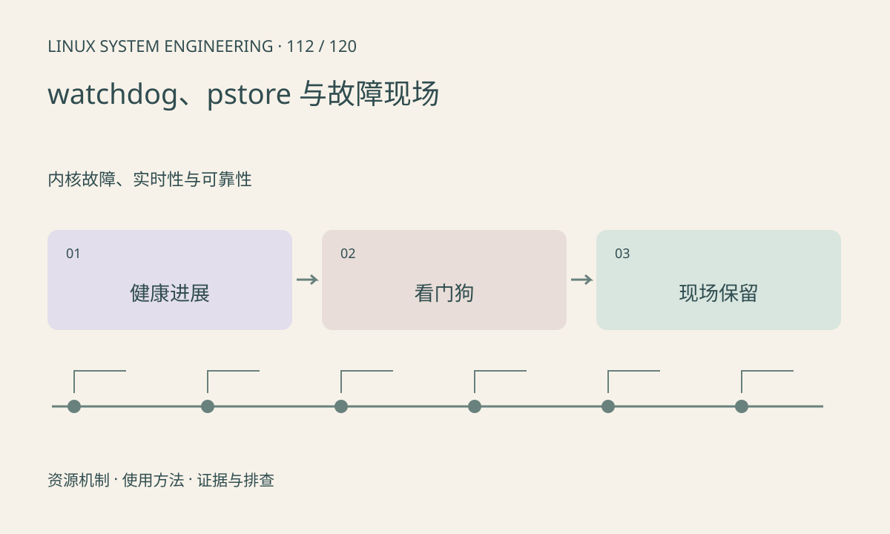

> 第 112 / 120 课 · 内核故障、实时性与可靠性。返回[课程合集](/series/embedded-linux-system-engineering/)。

## 机制与资源关系

硬件 watchdog 监测喂狗行为，不直接理解业务健康。应由健康状态决定是否喂狗，独立线程无条件喂狗会掩盖业务死锁。pstore/ramoops 可保存部分重启前信息，但保留能力受平台影响。



## 实际用法与观察入口

以下是操作说明；先确认执行环境、工具帮助和目标对象。设备名、PID、地址及项目名示例需要按实际替换，不能将整段命令当通用板端脚本执行。

```sh
ls /sys/class/watchdog
ls /sys/fs/pstore
cat /proc/sys/kernel/panic
```

## 输出解读与排查顺序

打开 /dev/watchdog 可能立即启用看门狗，本课不打开该节点。先验证恢复和日志持久化路径；ramoops 不能默认在断电后保留，保存成功也不保证记录覆盖全部原因。

### 情境推演

采集线程卡死但喂狗线程仍运行，整机永不重启。健康判断应检查帧序号是否推进以及各阶段时限；故障恢复后读取 pstore，不能让重启把唯一线索丢掉。

## 练习与参考分析

设计采集、推理、输出三路健康心跳及超时判据。参考结论：需要检查业务进展序号，单纯线程仍能执行 heartbeat 不代表流水线有新结果。

本课练习属于阅读、分析或板端观察。未在目标开发板执行，记录时应写明板型、内核配置、工具版本和原始输出。

## 官方资料与版本边界

- [本课参考资料](https://docs.kernel.org/admin-guide/ramoops.html)

内核、工具和厂商 BSP 的支持范围需分别核对。参考资料可能对应较新版本；不要据此推定旧 BSP 支持所有接口。

[上一课：suspend、runtime PM 与唤醒](/posts/linux-sys-111.html) · [下一课：cgroups、限制与资源压力](/posts/linux-sys-113.html)
