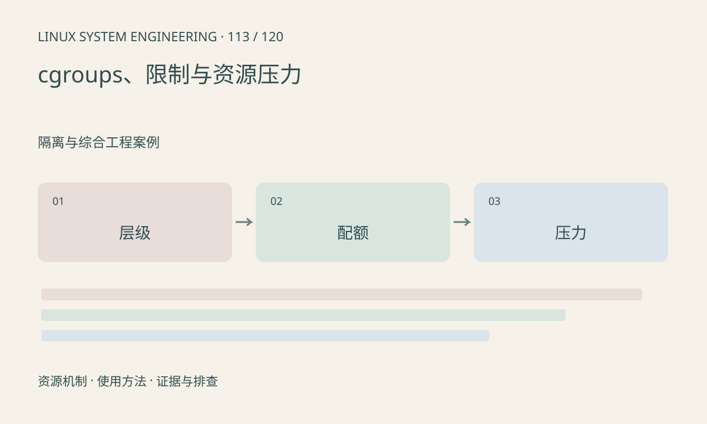

> 第 113 / 120 课 · 隔离与综合工程案例。返回[课程合集](/series/embedded-linux-system-engineering/)。

## 机制与资源关系

cgroup 把任务组织为层级并控制资源。v1 和 v2 接口不同，层级约束意味着子组设置不能突破父组限制。CPU 配额耗尽会产生等待，即使整机还有空闲 CPU。



## 实际用法与观察入口

以下是操作说明；先确认执行环境、工具帮助和目标对象。设备名、PID、地址及项目名示例需要按实际替换，不能将整段命令当通用板端脚本执行。

```sh
cat /proc/self/cgroup
cat /proc/mounts
# 仅 cgroup v2 根目录存在时
cat /sys/fs/cgroup/cgroup.controllers
```

## 输出解读与排查顺序

先定位进程所在组，再沿父层查 cpu.max、memory.max、events 和压力。根目录状态不等于业务组状态；本文不移动进程或修改限制。

### 情境推演

子组 cpu.max 看似不限，但父组有配额，子进程仍会节流。沿层级核对限制和 cpu.stat；只查询根 cgroup 或某个子目录无法解释完整约束。

## 练习与参考分析

构造 100ms 周期只允许 20ms CPU 时间的任务，解释约 0.2 核配额。参考结论：多线程不能突破总配额，增加线程可能更早耗尽预算。

本课练习属于阅读、分析或板端观察。未在目标开发板执行，记录时应写明板型、内核配置、工具版本和原始输出。

## 官方资料与版本边界

- [本课参考资料](https://docs.kernel.org/admin-guide/cgroup-v2.html)

内核、工具和厂商 BSP 的支持范围需分别核对。参考资料可能对应较新版本；不要据此推定旧 BSP 支持所有接口。

[上一课：watchdog、pstore 与故障现场](/posts/linux-sys-112.html) · [下一课：namespaces、容器与设备访问](/posts/linux-sys-114.html)
