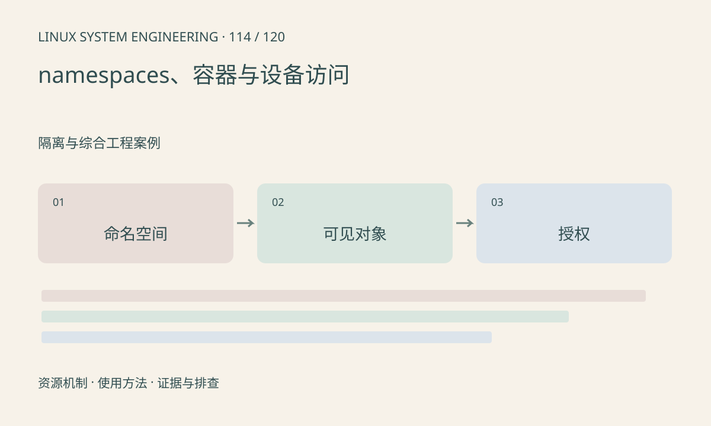

> 第 114 / 120 课 · 隔离与综合工程案例。返回[课程合集](/series/embedded-linux-system-engineering/)。

## 机制与资源关系

namespace 隔离可见视图，cgroup 管资源，容器共享宿主内核。PID、网络、挂载和用户命名空间分别改变观察结果。容器里看不到设备可能是节点、挂载、权限或设备策略问题。



## 实际用法与观察入口

以下是操作说明；先确认执行环境、工具帮助和目标对象。设备名、PID、地址及项目名示例需要按实际替换，不能将整段命令当通用板端脚本执行。

```sh
ls -l /proc/self/ns
cat /proc/self/cgroup
cat /proc/self/mountinfo
```

## 输出解读与排查顺序

比较故障进程与宿主的命名空间标识，再查设备访问链。不要把 --privileged 作为长期默认修复；容器镜像中安装驱动文件也不会自动替换宿主内核。

### 情境推演

容器看见 PID 1 与宿主 PID 1 不是同一个进程视图。排查进程和网络时记录 namespace，避免把容器内没有目标 PID 解释成宿主业务已经退出。

## 练习与参考分析

解释“容器有 /dev/video0 但 ioctl 失败”的可能层次。参考结论：节点映射仅解决入口，驱动、权限、SDK ABI 和资源仍需匹配。

本课练习属于阅读、分析或板端观察。未在目标开发板执行，记录时应写明板型、内核配置、工具版本和原始输出。

## 官方资料与版本边界

- [本课参考资料](https://man7.org/linux/man-pages/man7/namespaces.7.html)

内核、工具和厂商 BSP 的支持范围需分别核对。参考资料可能对应较新版本；不要据此推定旧 BSP 支持所有接口。

[上一课：cgroups、限制与资源压力](/posts/linux-sys-113.html) · [下一课：案例：启动和根文件系统失败](/posts/linux-sys-115.html)
