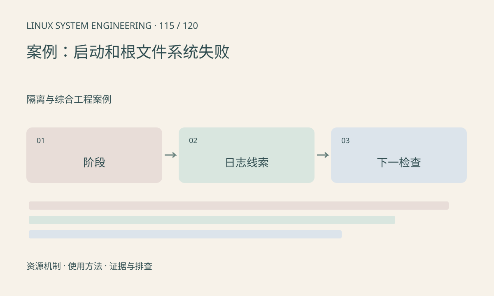

> 第 115 / 120 课 · 隔离与综合工程案例。返回[课程合集](/series/embedded-linux-system-engineering/)。

## 机制与资源关系

案例输入是构造日志，包含控制台已启动、根设备等待和 init 执行失败三类事件。排查先按最后一个已确认阶段划分，而不是看到最后一行就直接修改镜像。



## 实际用法与观察入口

以下是操作说明；先确认执行环境、工具帮助和目标对象。设备名、PID、地址及项目名示例需要按实际替换，不能将整段命令当通用板端脚本执行。

```sh
# 运行包内构造日志分类器，不连接开发板
python3 main.py
```

## 输出解读与排查顺序

根设备失败核对 root 参数、驱动内建、分区和文件系统；init 失败核对 ELF、解释器和依赖。分类器只标记线索，真实日志需结合完整上下文。

### 情境推演

构造样例中的 unknown 必须保持未知，不能为了给出结果强行归为存储问题。真实报告应补完整串口、启动参数和构建清单，再缩小范围。

## 练习与参考分析

将样例中 root device 错误替换为 No working init found。参考结论：下一步从设备路径转向用户空间执行链，工具不能替代阶段判断。

### 独立实验包

Python 标准库；仅对三行构造日志分类线索，未知信息保持 unknown。 默认入口、源文件和实际运行记录都在下载包中。

```experiment
practice
```

## 官方资料与版本边界

- [本课参考资料](https://docs.kernel.org/admin-guide/init.html)

内核、工具和厂商 BSP 的支持范围需分别核对。参考资料可能对应较新版本；不要据此推定旧 BSP 支持所有接口。

[上一课：namespaces、容器与设备访问](/posts/linux-sys-114.html) · [下一课：案例：摄像头无图、花屏与丢帧](/posts/linux-sys-116.html)
