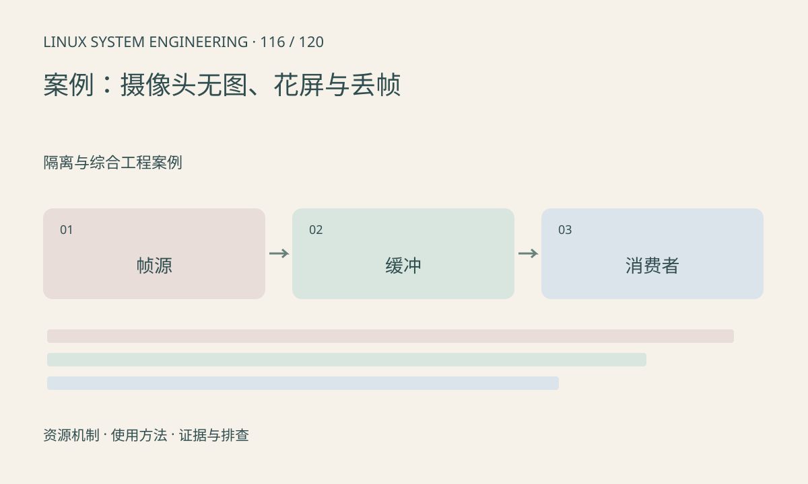

> 第 116 / 120 课 · 隔离与综合工程案例。返回[课程合集](/series/embedded-linux-system-engineering/)。

## 机制与资源关系

无图沿供电、控制、出流、接收、ISP、缓冲和应用逐层检查。花屏关注格式、stride、缓存和缓冲复用；丢帧关注帧序号、队列深度及各段处理速率。三种现象可能共享根因，也可能完全不同。



## 实际用法与观察入口

以下是操作说明；先确认执行环境、工具帮助和目标对象。设备名、PID、地址及项目名示例需要按实际替换，不能将整段命令当通用板端脚本执行。

```sh
cat /proc/interrupts
cat /proc/meminfo
# 仅适用于 V4L2 管线，厂商 SDK 使用对应查询入口
v4l2-ctl --list-devices
```

## 输出解读与排查顺序

保持 sensor mode 和输入场景一致，先保存原始帧再测试模型。不要一边改 ISP 参数一边换缓冲格式。DMA 完成与 CPU 可读、应用消费完成分别记录。

### 情境推演

帧日志从 11 跳到 14，同时应用启用了“只取最新帧”，跳号可能是主动策略。需要记录策略与丢弃位置，不能仅凭序号间断认定 CSI 丢包。

## 练习与参考分析

用样例帧日志找序号间断与持有缓冲增长。参考结论：只看到帧号跳跃不能区分采集端丢失与应用主动丢弃，需要记录丢弃位置和原因。

### 独立实验包

Python 标准库；构造帧序号和持有量，未接入摄像头。 默认入口、源文件和实际运行记录都在下载包中。

```experiment
practice
```

## 官方资料与版本边界

- [本课参考资料](https://docs.kernel.org/userspace-api/media/v4l/v4l2.html)

内核、工具和厂商 BSP 的支持范围需分别核对。参考资料可能对应较新版本；不要据此推定旧 BSP 支持所有接口。

[上一课：案例：启动和根文件系统失败](/posts/linux-sys-115.html) · [下一课：案例：NPU 变慢与缓冲分配失败](/posts/linux-sys-117.html)
