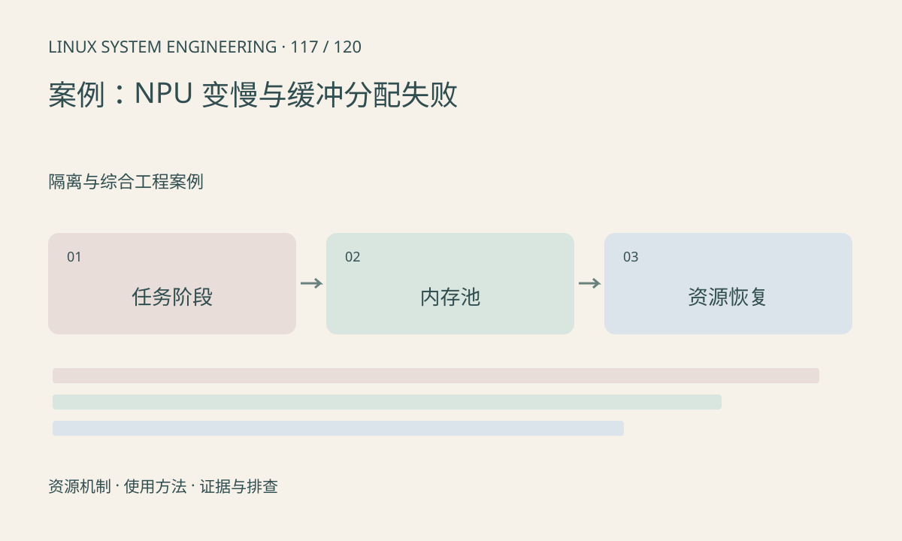

> 第 117 / 120 课 · 隔离与综合工程案例。返回[课程合集](/series/embedded-linux-system-engineering/)。

## 机制与资源关系

先把预处理、排队、设备执行、后处理和输出拆开，再核对模型、频率和输入形状。内存失败则按普通堆、CMA、厂商池和设备映射分别检查，不能只看 free。



## 实际用法与观察入口

以下是操作说明；先确认执行环境、工具帮助和目标对象。设备名、PID、地址及项目名示例需要按实际替换，不能将整段命令当通用板端脚本执行。

```sh
cat /proc/meminfo
cat /proc/buddyinfo
ls /sys/class/devfreq
# 厂商池和 NPU 统计按实际 SDK 查询
```

## 输出解读与排查顺序

比较冷态与稳态，核对回退算子和额外拷贝。每个缓冲记录申请及最终释放，避免把异步消费者未完成误判为分配器泄漏。

### 情境推演

推理执行时间不变，但任务从提交到完成的总时间增加，优先查队列和资源等待。池剩余持续下降时核对异常分支释放；频率和算法优化应在资源闭环之后评估。

## 练习与参考分析

构造 6 个池块、每帧持有 2 块的场景，最多同时容纳 3 帧且未计其他消费者。参考结论：无限加深队列会首先撞上池容量，需限制在途任务。

本课练习属于阅读、分析或板端观察。未在目标开发板执行，记录时应写明板型、内核配置、工具版本和原始输出。

## 官方资料与版本边界

- [本课参考资料](https://docs.kernel.org/driver-api/dma-buf.html)

内核、工具和厂商 BSP 的支持范围需分别核对。参考资料可能对应较新版本；不要据此推定旧 BSP 支持所有接口。

[上一课：案例：摄像头无图、花屏与丢帧](/posts/linux-sys-116.html) · [下一课：案例：网络视频卡顿与帧龄](/posts/linux-sys-118.html)
