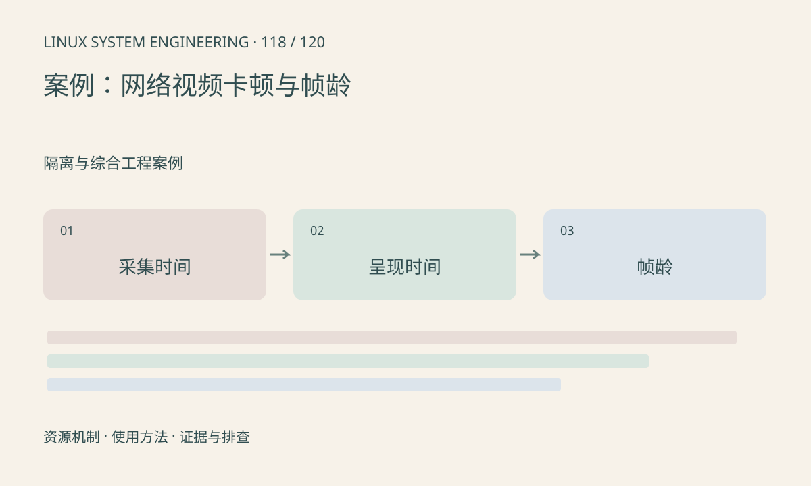

> 第 118 / 120 课 · 隔离与综合工程案例。返回[课程合集](/series/embedded-linux-system-engineering/)。

## 机制与资源关系

视频流的用户体验由采集到呈现的年龄决定，网络吞吐足够也可能积压旧帧。编码重排、socket 缓冲、接收队列和显示缓存都贡献延迟，丢帧策略还应符合编码依赖。



## 实际用法与观察入口

以下是操作说明；先确认执行环境、工具帮助和目标对象。设备名、PID、地址及项目名示例需要按实际替换，不能将整段命令当通用板端脚本执行。

```sh
ip -s link show
ss -ti
cat /proc/net/snmp
```

## 输出解读与排查顺序

同一时钟域下记录分段时间，跨设备先校准或估计偏差。不要任意丢压缩码流中的包或帧，可能破坏解码依赖；应在合适边界设计恢复和关键帧策略。

### 情境推演

视频看起来流畅但控制跟随慢，可能一直在播放旧帧。将最新帧时间与当前时间比较，注意时钟同步；流畅度和实时性是两个验收指标。

## 练习与参考分析

运行构造时序分析，比较处理时间和结果年龄。参考结论：若计算稳定但年龄持续增加，应优先查积压；盲目增加接收缓存会使延迟更大。

### 独立实验包

Python 3.10+ 标准库；构造时间线，不代表网络或 NPU 实测。 默认入口、源文件和实际运行记录都在下载包中。

```experiment
practice
```

## 官方资料与版本边界

- [本课参考资料](https://man7.org/linux/man-pages/man7/tcp.7.html)

内核、工具和厂商 BSP 的支持范围需分别核对。参考资料可能对应较新版本；不要据此推定旧 BSP 支持所有接口。

[上一课：案例：NPU 变慢与缓冲分配失败](/posts/linux-sys-117.html) · [下一课：案例：长期运行的内存与句柄增长](/posts/linux-sys-119.html)
