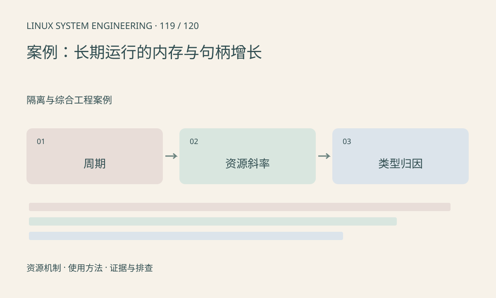

> 第 119 / 120 课 · 隔离与综合工程案例。返回[课程合集](/series/embedded-linux-system-engineering/)。

## 机制与资源关系

长期异常需要观察资源斜率和业务周期，而不是只看崩溃瞬间。记录 RSS、fd、线程、池块、连接和错误计数，可以区分预热平台期、周期波动和持续泄漏。



## 实际用法与观察入口

以下是操作说明；先确认执行环境、工具帮助和目标对象。设备名、PID、地址及项目名示例需要按实际替换，不能将整段命令当通用板端脚本执行。

```sh
# 替换为业务 PID，只读观察
cat /proc/1234/status
ls /proc/1234/fd
ls /proc/1234/task
```

## 输出解读与排查顺序

每轮连接、断开、重启和错误恢复都应回到可解释基线。fd 数量增长先分类类型，不能只提高 ulimit；RSS 增长则结合对象计数和分配器行为。

### 情境推演

样例每个连接周期多两个 fd，先按 /proc/PID/fd 链接分类 socket、pipe 或文件。找到具体类型后追踪创建和关闭配对，再验证修复后长时间回到稳定平台。

## 练习与参考分析

样例记录中 fd 每轮加 2 而 RSS 基本稳定，提出验证方法。参考结论：优先检查 socket/文件关闭路径，不能因 RSS 正常排除资源泄漏。

### 独立实验包

Python 标准库；分析构造趋势，不声称发现真实进程泄漏。 默认入口、源文件和实际运行记录都在下载包中。

```experiment
practice
```

## 官方资料与版本边界

- [本课参考资料](https://man7.org/linux/man-pages/man5/proc_pid_fd.5.html)

内核、工具和厂商 BSP 的支持范围需分别核对。参考资料可能对应较新版本；不要据此推定旧 BSP 支持所有接口。

[上一课：案例：网络视频卡顿与帧龄](/posts/linux-sys-118.html) · [下一课：整机验收与故障报告](/posts/linux-sys-120.html)
