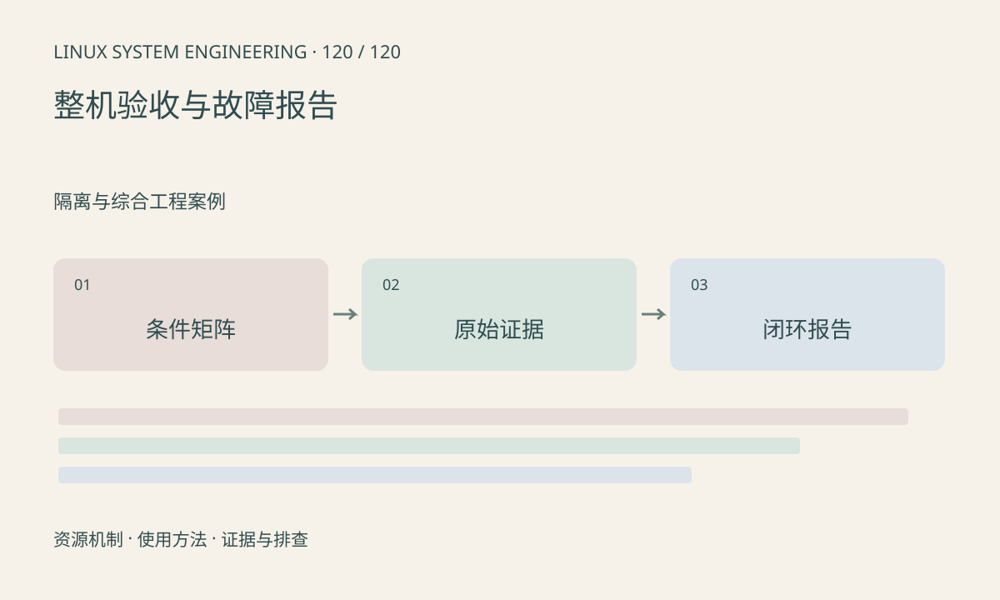

> 第 120 / 120 课 · 隔离与综合工程案例。返回[课程合集](/series/embedded-linux-system-engineering/)。

## 机制与资源关系

验收将功能、性能和恢复能力放在明确条件下测试。固定固件、硬件、模型和配置，定义吞吐、尾延迟、资源上限、温度及恢复时间。未执行的板端实验不能记为通过。



## 实际用法与观察入口

以下是操作说明；先确认执行环境、工具帮助和目标对象。设备名、PID、地址及项目名示例需要按实际替换，不能将整段命令当通用板端脚本执行。

```sh
# 本课包含报告模板、资源索引和有界只读采集脚本
sh collect.sh
```

## 输出解读与排查顺序

每个结论关联原始证据及条件，区分已验证、条件有限和未执行。保存最小复现输入和修改前后对照；恢复成功仍需说明根因是否消除。

### 情境推演

修复后只跑一次启动成功不足以覆盖原本三天后出现的故障。回归至少覆盖触发条件、错误恢复和资源趋势，并把未完成的长期验证保留为未执行。

## 练习与参考分析

用本课模板完成一个故障闭环：现象→影响→证据→假设→实验→修复→回归。参考结论：只写“重启后正常”属于恢复记录，尚未完成根因分析。

### 独立实验包

有界只读采集和可填写模板；不执行板端压力、掉电、升级或可靠性测试。 默认入口、源文件和实际运行记录都在下载包中。

```experiment
practice
```

## Linux 资源速查表

| 资源 | 观察入口 | 使用与管理接口 | 常见故障与下一步 |
|---|---|---|---|
| CPU/线程 | /proc/PID/task、/proc/stat、top | pthread、sched、affinity | 热点/等待：分别取执行栈和阻塞证据 |
| 调度约束 | /proc/PID/status、cgroup cpu.stat | 调度策略、cpuset、cpu.max | 空闲仍卡顿：查允许核和父组配额 |
| 用户内存 | status、maps、smaps_rollup | malloc/free、mmap/munmap | 增长：关联对象数、共享页与平台期 |
| 内核内存 | meminfo、slabinfo | 驱动对象生命周期 | 持续增长：查看对象数与错误路径 |
| 连续与媒体内存 | meminfo、reserved-memory、厂商统计 | DMA API、dma-buf、SDK 缓冲池 | 分配失败：查区域、对齐、在途量与释放 |
| 文件句柄 | /proc/PID/fd、limits、file-nr | open/close、dup、CLOEXEC | EMFILE：查句柄类型及关闭配对 |
| 存储 | mounts、diskstats、df、/proc/mtd | 文件系统/块层/MTD/UBI | 慢或只读：查错误、写回与介质状态 |
| 设备绑定 | /sys/bus、driver 链接、日志 | 驱动匹配、probe、资源管理 | 无节点：先查注册与绑定，再查 /dev 管理 |
| MMIO/IRQ | iomem、interrupts、softirqs | 内核 MMIO、IRQ API | 无完成：查提交、通知、清源和后续工作 |
| GPIO/时钟/电源 | gpioinfo、pinctrl/clk/regulator 调试信息 | 各内核资源框架 | 无响应：查复用、供应依赖及 runtime PM |
| 网络 | ip、ss、net/dev、抓包 | socket、路由、过滤规则 | 逐层查链路、邻居、路由、连接及业务 |
| 视频/音频/显示 | V4L2、media-ctl、ALSA、DRM | 各子系统及厂商 SDK | 查协商格式、队列所有权、时钟和呈现 |
| 电源与温度 | cpufreq、devfreq、thermal、power | PM 框架与策略 | 热态降速：对齐温度、频率和持续负载 |
| 故障现场 | 日志、core、pstore、符号产物 | 有界采集和受控调试 | 首错优先，保存精确构建和复现输入 |

这些入口并非每个 BSP 都有；不存在、不可读与数值为零必须分别记录。查询其他进程需相应权限。可写属性不得当普通配置文件盲写。


## 按现象查证据

| 现象 | 首先保存 | 第一轮判断 | 后续课程 |
|---|---|---|---|
| 程序无法启动 | 原始错误、ELF、挂载与身份 | 是否进入程序，加载器是否存在 | 89～95 |
| 高 CPU | 每线程占用、固定窗口采样 | 有效计算、重试还是忙轮询 | 25～32、97～104 |
| 低 CPU 卡顿 | 线程状态、等待位置、业务进度 | 等锁、等设备、等数据还是配额 | 29、32、56、113 |
| 内存持续增长 | RSS/PSS、对象数、池块和时长 | 预热、队列积压、泄漏或内核占用 | 33～40、119 |
| 有空闲但申请失败 | 请求大小、对齐、错误码、区域 | 限制、碎片、地址空间或特定池 | 38～39、117 |
| 删除后空间不降 | df/du、inode、deleted 句柄 | 打开引用、挂载遮蔽或统计口径 | 41～48 |
| 设备不出现 | 运行设备树、绑定和 probe 日志 | 描述、匹配、供应依赖或 /dev 管理 | 57～64 |
| 摄像头无图/花屏 | sensor mode、格式、stride、IRQ、帧号 | 出流、接收、缓冲、缓存或消费 | 76～80、116 |
| 网络不通 | 地址、具体路由、邻居、连接状态 | 链路→IP→传输→应用逐层验证 | 81～88 |
| NPU/视频慢 | 分段时间、温度、频率、队列深度 | 算力不足还是排队/搬运/降频 | 104、110、117～118 |
| 偶发重启 | 首错、复位原因、pstore、供电证据 | 软件异常、看门狗、温度或供电 | 105～112 |

每轮只改变一个变量；复现前约定停止条件、资源上限和恢复办法。未知项保持未知，不能把日志里没有某事件当作事件没有发生。


## 工具与环境适用表

| 环境 | 常见可用入口 | 需要确认的条件 | 缺失时的替代 |
|---|---|---|---|
| BusyBox BSP | Shell、基础 ps/top、/proc、/sys | applet 与选项按实际构建 | 读固定 proc 项，交叉编译所需工具 |
| systemd 发行版 | systemctl、journalctl | PID 1 和日志策略确为 systemd | 查看实际 init 脚本及文件日志 |
| Buildroot | 构建配置、自有包、overlay | 工具是可选包，内核独立配置 | 加入正式工程输入后重建 |
| Yocto | layer、recipe、image、SDK | 分支、MACHINE、DISTRO 和版本匹配 | 查展开变量和任务日志 |
| 容器 | 容器自身 /proc、挂载、网络视图 | namespace、capability、设备策略 | 在受控宿主采集对应视图 |
| strace/GDB | 用户程序调试 | ptrace 权限、符号及架构 | 应用错误日志、离线 core 分析 |
| perf | CPU 事件和采样 | PMU、配置、权限和符号 | 时间戳、用户态 profiling、tracepoints |
| ftrace | 内核事件/函数 | tracefs、配置、权限、缓冲 | 限量内核日志、应用埋点 |
| eBPF | 事件统计和动态观测 | 程序类型、helper、BTF、加载权限 | 已有 tracepoint 或用户态观测 |
| 硬件测量 | 波形、链路、电源证据 | 仪器、接法、带宽和额定范围 | 只能标未测，软件模型不能替代 |

不要把 GNU 命令选项直接套给 BusyBox。工具的 --help 与版本输出优先于照抄网页；内核文档也应切到目标 BSP 对应版本核对。


## 板端实验与故障报告模板

## 身份与条件

- 硬件型号/修订/编号：待填
- 内核、设备树、根文件系统、SDK、模型、配置校验：待填
- 工具链及工具版本：待填
- 输入、负载、温度、供电、运行时长：待填
- 权限、内核配置与缺失功能：待填

## 实验协议

- 目标与可证伪假设：待填
- 操作步骤及只读/状态变更分类：待填
- 预期结果、通过阈值、停止条件：待填
- 恢复与回退方法：待填
- 观测开销与时钟域：待填

## 证据与结论

| 项目 | 预期 | 实际 | 原始证据 | 状态 |
|---|---|---|---|---|
| 功能闭环 | 待定 | 未测 | 无 | 未执行 |
| 吞吐/尾延迟 | 待定 | 未测 | 无 | 未执行 |
| 内存/句柄/缓冲趋势 | 待定 | 未测 | 无 | 未执行 |
| 热稳态与长期运行 | 待定 | 未测 | 无 | 未执行 |
| 异常恢复/升级回退 | 待定 | 未测 | 无 | 未执行 |

状态只使用：已验证、条件有限、未执行、失败。假设、观察值和最终结论分开记录。

## 修复与回归

记录现象、影响、首次出现版本、最小复现、排除过程、根因证据、修复行为及回归范围。重启恢复不等于根因已修复。未完成的长期验证继续保留为未执行。


## 官方资料与版本边界

- [本课参考资料](https://docs.kernel.org/admin-guide/reporting-issues.html)

内核、工具和厂商 BSP 的支持范围需分别核对。参考资料可能对应较新版本；不要据此推定旧 BSP 支持所有接口。

[上一课：案例：长期运行的内存与句柄增长](/posts/linux-sys-119.html)
