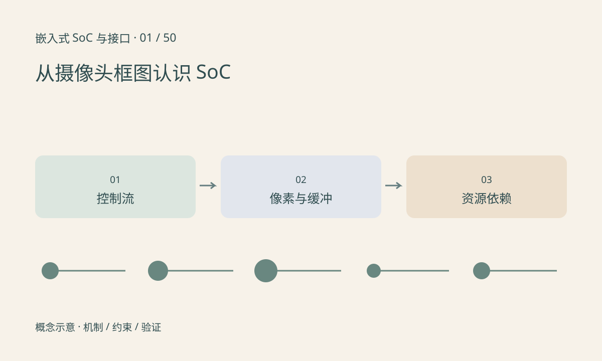

> 第 1 / 50 课 · 核心课程。返回[课程合集](/series/embedded-soc-interfaces/)。

## 先沿一帧图像走一遍

典型摄像头链路可以写成传感器→CSI 接收→ISP→图像缓冲→缩放或颜色转换→NPU，也可以分出一路送视频编码器或显示。实际芯片可能在模块间使用片内通路而不把每一步都写回 DDR，必须看芯片框图和 SDK 的绑定关系。

CPU 负责启动、配置、调度和一部分计算，不表示每个像素都由 CPU 逐个搬运。I²C 配置传感器寄存器，CSI-2 传输图像，这两条路径不能混为一谈：读到 sensor ID 只证明控制路径部分工作。

## 给框图补上三个层次

第一层标处理模块及输入输出格式；第二层标 SRAM、DDR 和缓冲所有权；第三层标电源、时钟、复位、引脚和中断依赖。同一个“无图像”现象，可能来自任何一层。

数据流箭头应写清 RAW10、NV12、RGB 或压缩码流等格式。控制流箭头写配置接口、状态通知与错误返回。不要用一根无含义的线代表所有联系。

## 课程边界与学习顺序

01～07 建立电气与时序基础，08～18 认识计算单元和启动存储，19～26 追踪地址与数据搬运，27～41 学外设和多媒体接口，42～45 进入驱动、实时性与排障。46～50 是无线、工业网络、FPGA、长距离视频和可靠性选修。

本系列讲通用机制；寄存器地址、电压、时序和支持模式以实际芯片版本文档为准。已写的[ISP 基础](/series/isp-basics/)、[NPU 转换](/series/hi3516-npu-conversion/)和[视觉进阶](/series/edge-vision-advanced/)分别承接图像处理、工具链和模型任务。

## 练习与参考结论

画一张自己项目的框图，为每条数据箭头填写格式、尺寸、帧率和缓冲位置。再遮住 SDK API 名称，解释每个模块的职责。

参考检查：1920×1080 的 NV12 有效数据约为 3.11 MB/帧，30 帧每秒仅一次线性传输约为 93.31 MB/s。这个值不包含 stride 对齐、读回、协议与仲裁开销，不能当作整机 DDR 带宽。

## 完整课程目录

- 01 [从摄像头框图认识 SoC](/posts/soc-01-system-map.html)
- 02 [电平、地与逻辑阈值](/posts/soc-02-logic-levels.html)
- 03 [差分、阻抗、端接与信号完整性](/posts/soc-03-signal-integrity.html)
- 04 [PMIC、供电时序与掉电行为](/posts/soc-04-power-sequencing.html)
- 05 [晶振、PLL、时钟树与跨时钟域](/posts/soc-05-clocks-cdc.html)
- 06 [复位域、看门狗与故障恢复](/posts/soc-06-reset-watchdog.html)
- 07 [ADC、DAC、参考电压与采样](/posts/soc-07-adc-dac.html)
- 08 [MCU、MPU、SoC 与操作系统](/posts/soc-08-mcu-mpu-os.html)
- 09 [CPU、异常、中断与多核](/posts/soc-09-cpu-interrupts.html)
- 10 [GPU：并行计算、图形与数据搬运](/posts/soc-10-gpu-compute.html)
- 11 [DSP：滤波、FFT、定点数与饱和](/posts/soc-11-dsp-fixed-point.html)
- 12 [NPU：张量计算、片上存储与 TOPS](/posts/soc-12-npu-architecture.html)
- 13 [ISP：从传感器 RAW 到可用图像](/posts/soc-13-isp-pipeline.html)
- 14 [视频编解码器与图像加速器](/posts/soc-14-codec-accelerators.html)
- 15 [Boot ROM、Bootloader 与系统启动](/posts/soc-15-boot-chain.html)
- 16 [NOR、NAND、擦写与 ECC](/posts/soc-16-flash-ecc.html)
- 17 [eMMC：总线模式、内部管理与分区](/posts/soc-17-emmc-storage.html)
- 18 [安全启动、固件签名与 A/B 升级](/posts/soc-18-secure-update.html)
- 19 [寄存器、地址空间与 MMIO](/posts/soc-19-mmio-registers.html)
- 20 [SRAM、DDR、带宽与延迟](/posts/soc-20-memory-bandwidth.html)
- 21 [Cache、一致性与可见性](/posts/soc-21-cache-coherence.html)
- 22 [DMA、描述符与环形缓冲](/posts/soc-22-dma-rings.html)
- 23 [MMU、IOMMU 与三种地址](/posts/soc-23-mmu-iommu.html)
- 24 [AXI、AHB、APB 与片内互连](/posts/soc-24-amba-interconnect.html)
- 25 [零拷贝、dma-buf 与缓冲生命周期](/posts/soc-25-zero-copy.html)
- 26 [共享内存、Mailbox 与核间通信](/posts/soc-26-heterogeneous-ipc.html)
- 27 [GPIO、Pinmux、上下拉与引脚状态](/posts/soc-27-gpio-pinmux.html)
- 28 [UART、RS-232 与 RS-485](/posts/soc-28-uart-rs485.html)
- 29 [I²C：地址、ACK、重复起始与上拉](/posts/soc-29-i2c.html)
- 30 [SPI、QSPI 与 Flash 访问](/posts/soc-30-spi-qspi.html)
- 31 [定时器、PWM、输入捕获与编码器](/posts/soc-31-timers-pwm.html)
- 32 [I²S、PCM、TDM 与音频时钟](/posts/soc-32-audio-i2s.html)
- 33 [CAN 与 CAN FD：仲裁、帧和错误状态](/posts/soc-33-can-fd.html)
- 34 [USB：角色、端点、传输类型与 UVC](/posts/soc-34-usb-uvc.html)
- 35 [SD 与 SDIO：存储卡和外设功能](/posts/soc-35-sd-sdio.html)
- 36 [Ethernet：MAC、PHY、MDIO 与吞吐](/posts/soc-36-ethernet.html)
- 37 [PCIe：链路、枚举、BAR、中断与 DMA](/posts/soc-37-pcie.html)
- 38 [MIPI 全景：CSI、DSI 与 PHY](/posts/soc-38-mipi-layers.html)
- 39 [摄像头接入：供电、复位、MCLK 与配置](/posts/soc-39-sensor-bringup.html)
- 40 [CSI-2：数据类型、虚拟通道与带宽预算](/posts/soc-40-csi-bandwidth.html)
- 41 [显示链路：DSI、RGB、LVDS 与 HDMI](/posts/soc-41-display-interfaces.html)
- 42 [设备树、probe、IRQ 与资源生命周期](/posts/soc-42-linux-driver-resources.html)
- 43 [实时性、中断延迟与优先级反转](/posts/soc-43-realtime-scheduling.html)
- 44 [万用表、示波器、逻辑分析仪与 JTAG](/posts/soc-44-debug-instruments.html)
- 45 [综合排障：无图、花屏、丢帧与 NPU 慢](/posts/soc-45-system-troubleshooting.html)
- 46 [选修：Wi-Fi、Bluetooth 与蜂窝通信](/posts/soc-46-wireless.html)
- 47 [选修：工业以太网、EtherCAT 与 TSN](/posts/soc-47-industrial-network.html)
- 48 [选修：FPGA、流水线与时序约束](/posts/soc-48-fpga.html)
- 49 [选修：长距离视频 SerDes 与 A-PHY](/posts/soc-49-camera-serdes.html)
- 50 [选修：温度、功耗、EMC 与长期可靠性](/posts/soc-50-reliability-validation.html)

## 延伸阅读

- [官方资料：从摄像头框图认识 SoC](https://www.arm.com/architecture/system-architectures/amba)

[下一课：电平、地与逻辑阈值](/posts/soc-02-logic-levels.html)
