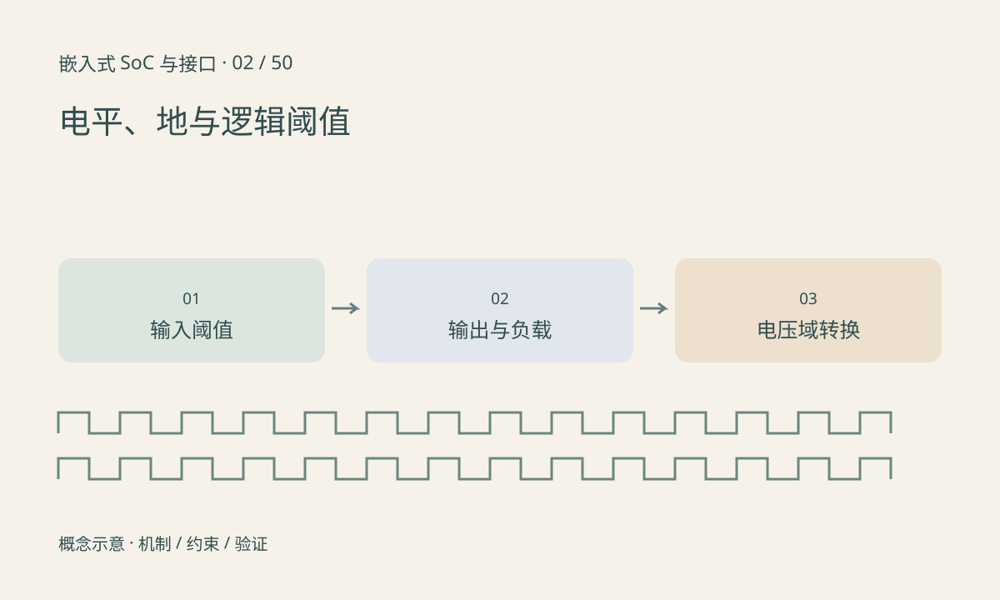

> 第 2 / 50 课 · 核心课程。返回[课程合集](/series/embedded-soc-interfaces/)。

## 逻辑 1 不是统一的电压

输入规格中的 VIH、VIL 给出保证识别高低电平的范围，输出规格中的 VOH、VOL 要结合负载电流读取。两个器件供电都写“3.3V”，也不能省略阈值和容限检查；绝对最大额定值不是正常工作点。

推挽输出主动驱动高低，开漏输出通常只下拉，需要外部或内部上拉。两个推挽输出直接相连可能发生争用。开漏线的高电平由上拉电源决定，上拉到 3.3V 的线不一定能直接接不耐受该电压的 1.8V 输入。

## 电平转换还涉及方向与上电状态

先确认单向、双向、是否开漏、速率和负载，再选转换方案。能用于低速开漏总线的电路，不应默认适合高速推挽时钟。还要检查某一侧掉电时是否反向供电，器件是否支持掉电隔离。

信号电压相对于参考地测量。地线压降、不同电源域和长回流路径可能让发送端看似正常的电平，在接收端越过阈值。测量时标明探头参考点，不能只记录一个没有位置的电压值。

## 练习与参考结论

构造一组规格：发送端保证 VOH≥2.4V，接收端要求 VIH≥2.8V。判断是否保证识别。

答案：不保证，尽管万用表在轻载时可能测到 3.3V。用两个实际器件的数据手册制作兼容表，分别记录阈值、驱动电流、输入容限和单边掉电行为；不要在未经核对的板上用短接试错。

## 延伸阅读

- [官方资料：电平、地与逻辑阈值](https://www.ti.com/lit/an/scea021a/scea021a.pdf)

[上一课：从摄像头框图认识 SoC](/posts/soc-01-system-map.html) · [下一课：差分、阻抗、端接与信号完整性](/posts/soc-03-signal-integrity.html)
