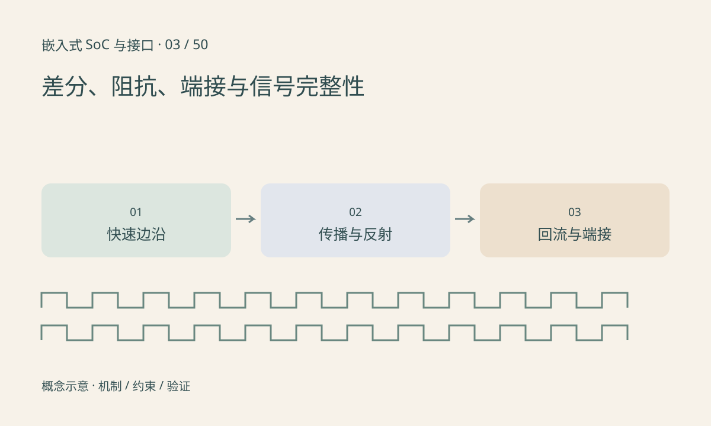

> 第 3 / 50 课 · 核心课程。返回[课程合集](/series/embedded-soc-interfaces/)。

## 边沿决定何时必须把线当作传输线

总线时钟不高，也可能有很快的上升沿。走线传播时间与边沿时间可比时，负载端与源端不再同时看到一个理想电压。阻抗不连续产生反射，过冲和振铃可能导致重复采样或超过电压容限。

终端电阻的类型和位置由拓扑、驱动器与接口规范决定。不能看到差分线就随意加 100Ω，也不能把单端串联源端匹配套到所有总线。

## 差分不意味着不需要参考

接收器主要判断两线电压差，但仍有允许的共模范围。差分对不平衡、连接器或保护器件的不对称会把差模转换成共模。返回路径被割裂、层间换层缺少合理回流等问题，可能表现为干扰而非逻辑错误。

ESD 保护器件还带来寄生电容；器件位置、回流和线长会影响保护效果与高速信号。满足信号完整性不等于通过电磁兼容测试，两者有关联但目标不同。

## 练习与参考结论

在纸上画源端、走线、连接器、接收端和回流路径，标出每个阻抗变化点。构造 500ps 的边沿与 1ns 的单程传播时间，说明为什么不能用集中参数导线近似。

仪器练习先选择低压、已知波形的测试点，比较长地线与短接地方式的测量差异。高速差分眼图需要合适探头、带宽与测试方法，普通逻辑分析仪不能证明眼图裕量。

## 延伸阅读

- [官方资料：差分、阻抗、端接与信号完整性](https://www.ti.com/lit/an/snla028/snla028.pdf)

[上一课：电平、地与逻辑阈值](/posts/soc-02-logic-levels.html) · [下一课：PMIC、供电时序与掉电行为](/posts/soc-04-power-sequencing.html)
