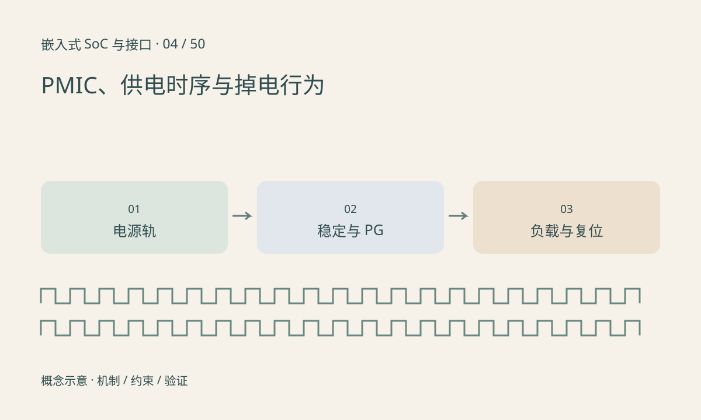

> 第 4 / 50 课 · 核心课程。返回[课程合集](/series/embedded-soc-interfaces/)。

## 芯片有电不等于所有电源域都正常

SoC 可能具有核心、DDR、模拟、I/O 等不同电源域，电压和先后关系由器件规定。PMIC 或分立稳压器负责供电，软件配置只能在其自身能够工作的条件下生效，不能替代上电前的硬件默认状态。

区分 enable 命令、电压实际建立与 power-good 指示。固定延时可以是时序的一部分，但若电源没有稳定，延时到期不应自动等同于允许释放复位。

## 瞬态比稳态平均值更容易暴露问题

启动 NPU、打开无线发射或同时拉起多个外设会改变电流。线路压降、供电响应与去耦不足可能导致瞬时跌落。万用表显示正常不能排除短暂 brownout；应把电源波形与复位、负载事件一起触发记录。

掉电顺序也可能有要求。外部接口在主电源消失后仍被驱动，会通过保护结构反向供电。确认 I/O 在上电和掉电过程中的状态，而不是仅检查稳定运行时。

## 练习与参考结论

为一块板建立电源时序表：轨名、目标电压、容差、上升时间、依赖项、PG 信号和负载。先按原理图与手册填写“要求”，测量后另列“观察值”。

构造事件：核心电源 PG 为假，但启动定时器已到期。正确结论是资源条件未满足，不能只因等待了 10ms 就释放依赖该电源的模块复位。实际阈值不能沿用这个教学数值。

## 延伸阅读

- [官方资料：PMIC、供电时序与掉电行为](https://docs.kernel.org/power/regulator/overview.html)

[上一课：差分、阻抗、端接与信号完整性](/posts/soc-03-signal-integrity.html) · [下一课：晶振、PLL、时钟树与跨时钟域](/posts/soc-05-clocks-cdc.html)
