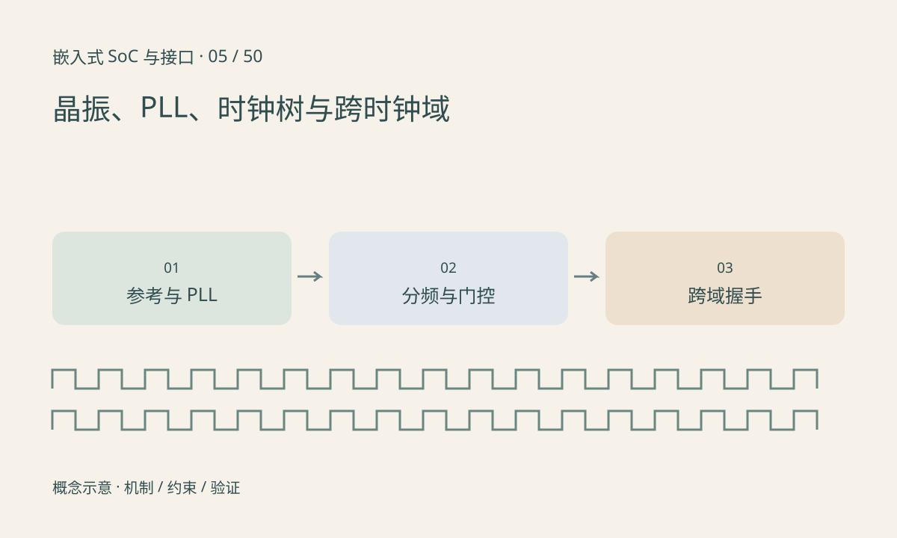

> 第 5 / 50 课 · 核心课程。返回[课程合集](/series/embedded-soc-interfaces/)。

## 一个频率值背后是一棵树

晶振或外部参考输入经 PLL、mux 和分频器提供各模块时钟。PLL 倍频关系只是理想频率计算，输入范围、VCO 范围、锁定时间和抖动也受限制。时钟源切换和门控需遵循硬件规定，不能把任意寄存器写入都视为无毛刺操作。

Linux 的 clock framework 表达时钟依赖与控制，但驱动申请到时钟句柄不代表时钟已经使能。设备启停时应配对管理资源，并确认实际父时钟和频率。

## CDC 解决的不是单纯频率差

两个时钟即使名义频率相同，若相位关系不受约束，也可能属于异步时钟域。接收边沿附近变化的信号可能导致亚稳态。单比特状态可采用合适的同步器；多比特数据不能简单给每一位各串两级触发器就保证整体一致。

握手、异步 FIFO 和 Gray 码指针是常见方法，适用条件不同。软件内存屏障不能修复硬件 CDC 设计，降低频率也不能自动证明跨域正确。



## 练习与参考结论

先计算 24MHz 参考、理想倍频 50、分频 4 时得到 300MHz，再查实际 PLL 允许的参数范围。代码只验证算术，不证明配置合法。

解释为何 8 位计数器从 0x7F 变为 0x80 时逐位同步可能观察到混合值。答案：多位同时变化且采样结果不保证一致，需要整体数据传递协议。

### 配套代码

下载包包含独立运行所需文件，使用 Python 标准库；这里验证机制和计算，不代表开发板测量结果。

```experiment
practice
```

## 延伸阅读

- [官方资料：晶振、PLL、时钟树与跨时钟域](https://docs.kernel.org/driver-api/clk.html)

[上一课：PMIC、供电时序与掉电行为](/posts/soc-04-power-sequencing.html) · [下一课：复位域、看门狗与故障恢复](/posts/soc-06-reset-watchdog.html)
