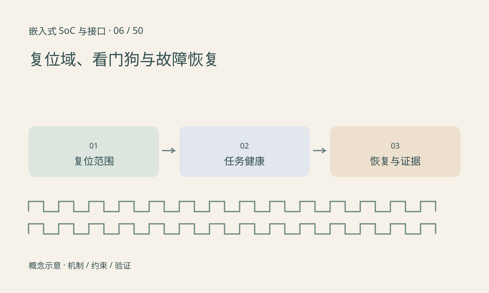

> 第 6 / 50 课 · 核心课程。返回[课程合集](/series/embedded-soc-interfaces/)。

## 复位的覆盖范围不同

外设复位可能只清其寄存器和状态机，CPU reset、系统 reset 与掉电重启覆盖的状态也不同。内存、保持域或外部器件不一定同步复位。因此“重启软件后好了”并不能说明故障来源已经消失。

reset assert/deassert 的先后和最短保持时间按芯片要求执行。共享复位线影响多个使用者，驱动不能把它当成自己的私有开关。复位后还要恢复必要配置、缓冲和中断状态。

## 看门狗应反映业务是否推进

一个独立线程持续喂狗，只能证明它自己还活着。关键任务卡死、数据链停滞而喂狗线程照常运行，就失去了故障恢复意义。可以让多个模块提交带时限的健康证据，再由集中策略决定是否喂狗。

看门狗可能有窗口、预超时中断和启用后不可关闭等行为。不要在不清楚驱动语义时随便打开 `/dev/watchdog` 进行试验。本文的离线事件练习不操作硬件看门狗。

## 练习与参考结论

构造三个任务的最近完成时间：采集 100ms、推理 105ms、保存 20ms，当前 120ms，各任务允许停顿 50ms。应判定保存任务失去进展，而不是因为推理仍在运行就继续报告全系统健康。

板端交付应记录复位原因、最后正常任务和恢复次数；若启动后不断再次复位，应进入受控恢复状态，避免无限重启掩盖故障。

## 延伸阅读

- [官方资料：复位域、看门狗与故障恢复](https://docs.kernel.org/watchdog/watchdog-api.html)

[上一课：晶振、PLL、时钟树与跨时钟域](/posts/soc-05-clocks-cdc.html) · [下一课：ADC、DAC、参考电压与采样](/posts/soc-07-adc-dac.html)
