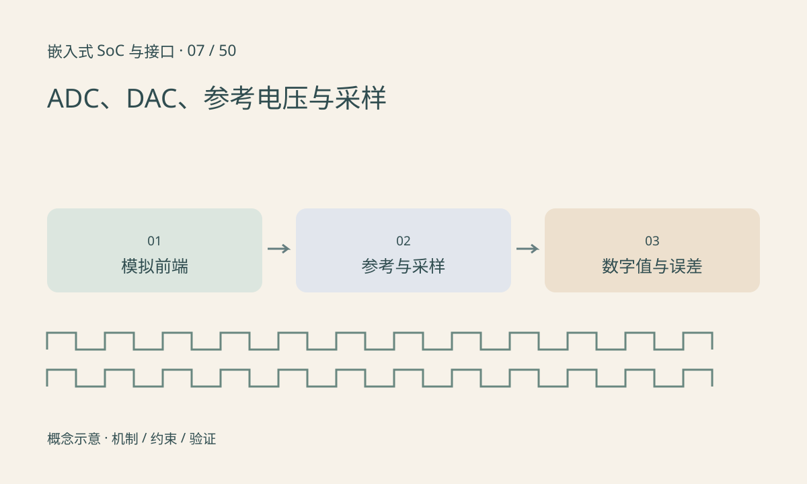

> 第 7 / 50 课 · 核心课程。返回[课程合集](/series/embedded-soc-interfaces/)。

## 分辨率不等于准确度

理想 N 位单极性 ADC 的量化间隔常按 `Vref/2^N` 理解，真实传递曲线、端点定义按器件手册。失调、增益误差、噪声、参考漂移和输入驱动能力都会影响有效结果，12 位输出不表示每次测量都有 12 位准确度。

DAC 把数字值转成模拟量，同样受参考、负载、输出摆幅和建立时间限制。PWM 加低通可以形成平均电压，但不能不说明纹波、响应和负载就把它等同于专用 DAC。

## 采样前就要处理混叠

采样率为 1kHz 时，800Hz 正弦可能表现为低频混叠分量。采样后再做数字低通不能恢复已经混在一起的频率。模拟抗混叠滤波、输入带宽和采样时钟共同决定可测信号范围。

复用多通道 ADC 还需考虑切换后的采样建立时间，尤其是高源阻抗输入。多个通道一轮的总吞吐不等于每个通道都能达到该采样率。



## 练习与参考结论

配套计算得到 3.3V、12 位的理想间隔约 0.806mV，并比较 800Hz 与其混叠频率。所有输入是构造值。

硬件练习用已知低压直流源记录均值、极值和参考电压，再改变采样时间或源阻抗。先确保输入在允许范围内，测量接线及保护属于实验条件，不能由量化公式代替。

### 配套代码

下载包包含独立运行所需文件，使用 Python 标准库；这里验证机制和计算，不代表开发板测量结果。

```experiment
practice
```

## 延伸阅读

- [官方资料：ADC、DAC、参考电压与采样](https://docs.kernel.org/driver-api/iio/index.html)

[上一课：复位域、看门狗与故障恢复](/posts/soc-06-reset-watchdog.html) · [下一课：MCU、MPU、SoC 与操作系统](/posts/soc-08-mcu-mpu-os.html)
