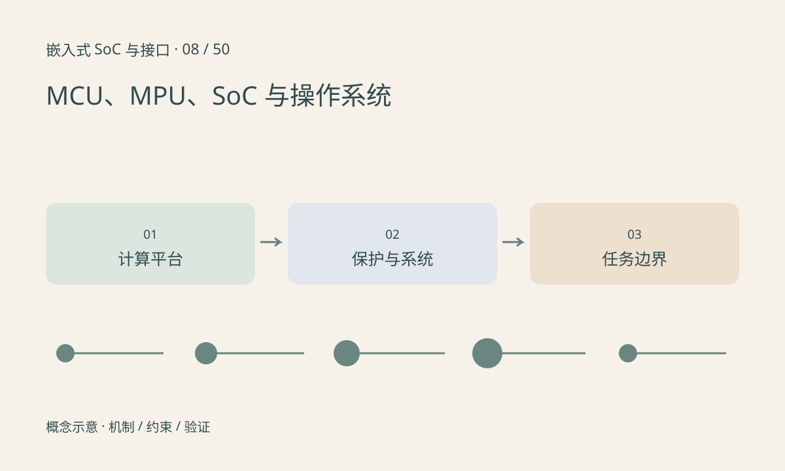

> 第 8 / 50 课 · 核心课程。返回[课程合集](/series/embedded-soc-interfaces/)。

## 名称不是严格互斥的硬件集合

MCU 常强调片上存储和控制外设，微处理器应用常配外部内存和复杂操作系统，SoC 强调整合多个功能。但这些是产品定位与实现的常见特征，不是只凭有没有 Linux 就能完成的分类。

MPU 这个缩写还可能表示 Memory Protection Unit，即内存保护单元，与 microprocessor 的简称不同。读数据手册时应先看上下文，不能把内存保护模块当作一颗额外 CPU。

## 裸机、RTOS 与 Linux 如何选择

裸机也可以使用中断和状态机，但任务调度、隔离与资源管理需要自行组织。RTOS 提供任务、同步和时间机制，仍需正确设计优先级和最坏执行时间。Linux 提供丰富驱动和进程机制，实时性取决于配置、负载和整个软硬件路径。

操作系统不是算力等级。一个功能较简单但有严格时限的控制环，可能适合放在独立 MCU 上，让运行 Linux 的应用核负责网络、文件和推理，两者通过明确协议协作。

## 练习与参考结论

把项目任务分成电机控制、图像推理、联网升级三项，分别填写时限、抖动容忍度、内存需求与失败后果。

参考结论：不能只按代码行数选择系统。硬实时任务需要分析最坏路径；复杂业务需要生命周期与故障隔离。先画边界再讨论放在哪个核上。

## 延伸阅读

- [官方资料：MCU、MPU、SoC 与操作系统](https://www.freertos.org/Documentation/02-Kernel/02-Kernel-features/01-Tasks-and-co-routines/01-Tasks-overview)

[上一课：ADC、DAC、参考电压与采样](/posts/soc-07-adc-dac.html) · [下一课：CPU、异常、中断与多核](/posts/soc-09-cpu-interrupts.html)
