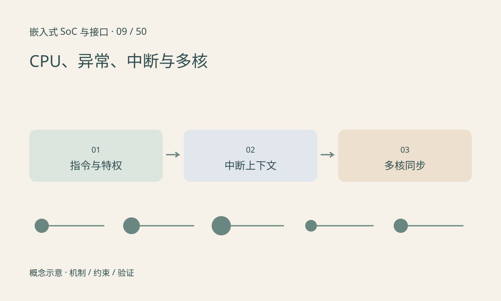

> 第 9 / 50 课 · 核心课程。返回[课程合集](/series/embedded-soc-interfaces/)。

## CPU 不只是顺序执行 C 语句

编译器与处理器会在体系结构允许范围内改变执行方式，缓存和分支预测影响耗时。C 代码中的先后顺序并不直接等于外设观察到的时序；设备访问要用平台提供的 API 和同步机制。

异常可能由当前指令引起，中断通常来自外部事件；具体命名与优先级按架构规定。进入处理程序需要保存上下文、确定来源和清除或屏蔽条件。若电平中断源仍保持有效，仅在控制器层确认中断可能导致不断再次进入。

## 特权级与任务上下文

用户程序通过系统调用请求内核服务，不应随意访问设备物理地址。中断上下文与普通可调度线程不同，允许的操作和阻塞条件不同。把耗时工作转移到合适的后半部或线程，是为了控制响应与调度影响。

多核能同时执行任务，但共享状态需要同步。缓存一致性不能自动让多步业务操作变成原子事务，单核运行正确的环形队列也未必在多核下正确。

## 练习与参考结论

画出外设事件→中断控制器→处理程序→唤醒线程→用户处理的路径，分别标注排队和执行时间。平均 100µs 不能排除某次延迟 10ms。

在不改变系统配置的前提下，可阅读 `/proc/interrupts` 比较事件发生前后计数。计数增长只证明中断到达，不证明驱动正确消费数据，也不证明时限达标。

## 延伸阅读

- [官方资料：CPU、异常、中断与多核](https://docs.kernel.org/core-api/genericirq.html)

[上一课：MCU、MPU、SoC 与操作系统](/posts/soc-08-mcu-mpu-os.html) · [下一课：GPU：并行计算、图形与数据搬运](/posts/soc-10-gpu-compute.html)
