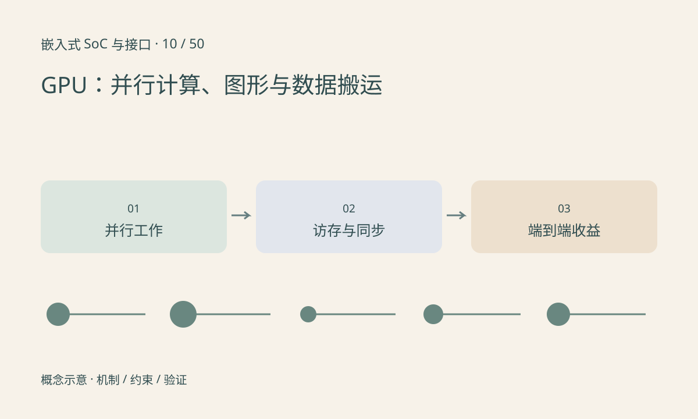

> 第 10 / 50 课 · 核心课程。返回[课程合集](/series/embedded-soc-interfaces/)。

## 大量并行工作才容易摊薄成本

GPU 将许多相似运算分派到并行执行资源。图形渲染与通用计算共享部分硬件思想，但可用 API、驱动与能力取决于设备。芯片集成 GPU 不代表 SDK 一定开放可用于推理的计算接口。

并行线程访问连续内存通常更容易有效利用带宽；分支分歧、频繁同步与小工作量会降低收益。不能只比较 CPU 和 GPU 的峰值运算数，还要考虑任务是否能保持足够并行。

## 端到端收益包括搬运

一次加速可能包含上传、kernel 提交、计算、同步和下载。若 CPU 只需 2ms，而数据转换和搬运已占 3ms，即使 GPU 计算只需 0.2ms，也没有端到端加速。

共享物理内存不一定消除同步和所有格式转换。GPU 输出可能需要特定布局，交给显示或 NPU 时仍要确认缓冲导入能力及完成事件。

GPU、DSP 与 NPU 的分工应按实际算子、输入规模、延迟和功耗测量，而不是固定规定所有图像操作都属于 GPU。

## 练习与参考结论

比较两种构造方案：CPU 计算 8ms；GPU 上传 2ms、提交与同步 1ms、计算 1ms、下载 2ms。完整路径为 6ms，而不是只拿 1ms 宣称八倍加速。

若后续模块可直接消费 GPU 缓冲，重新画所有权与同步路径，再讨论能否减少搬运。不得把“零拷贝”的名字当作已经完成优化的证据。

## 延伸阅读

- [官方资料：GPU：并行计算、图形与数据搬运](https://www.khronos.org/opencl/)

[上一课：CPU、异常、中断与多核](/posts/soc-09-cpu-interrupts.html) · [下一课：DSP：滤波、FFT、定点数与饱和](/posts/soc-11-dsp-fixed-point.html)
