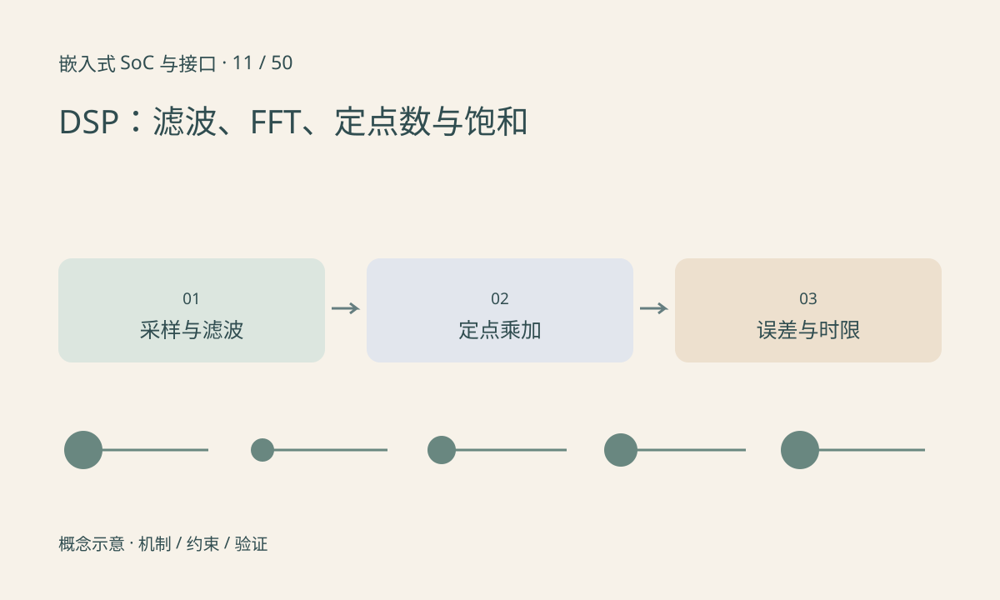

> 第 11 / 50 课 · 核心课程。返回[课程合集](/series/embedded-soc-interfaces/)。

## DSP 是任务，也可能是一类处理器

数字信号处理包括采样序列上的滤波、频谱分析、调制等运算；DSP 处理器则常针对乘加、循环、数据寻址和实时流设计。CPU 也可以带 DSP 指令扩展，因此看到“支持 DSP”需要继续问：独立核、指令扩展还是软件库？

FIR 滤波把有限段输入与系数相乘累加。长度 L、每秒 Fs 个样本，单通道直接实现大约需要 L×Fs 次乘加；多通道要继续乘通道数。FFT 将信号转为频率表示，采样率和窗口长度决定频率格点，补零不会凭空增加原始观测信息。

## 定点需要明确缩放与溢出

有符号 Q15 常把整数除以 32768 解释为实数，范围为 [-1,1)。乘法结果通常需要更宽累加器，最后按约定舍入、移位和饱和。直接让整数回绕会把大的正数变成负数，造成明显失真。

浮点不等于无限精度；定点也不等于低质量。应先建立浮点参考，再测量定点误差、峰值余量和最坏执行时间。整个音频帧的截止时间还包括 DMA、缓存同步与调度。



## 练习与参考结论

代码实现四点滑动平均和 Q15 饱和加法。检查 0.75+0.75 在饱和下接近 1，而在 16 位回绕下成为 -0.5。

把输入改为阶跃，观察滤波延迟；把采样率翻倍但保留系数，解释为什么对应的物理频率响应改变。实际 DSP 上还需测量每块处理周期和缓冲欠载，PC 上的 Python 时间不是 DSP 性能。

### 配套代码

下载包包含独立运行所需文件，使用 Python 标准库；这里验证机制和计算，不代表开发板测量结果。

```experiment
practice
```

## 延伸阅读

- [官方资料：DSP：滤波、FFT、定点数与饱和](https://arm-software.github.io/CMSIS-DSP/main/index.html)

[上一课：GPU：并行计算、图形与数据搬运](/posts/soc-10-gpu-compute.html) · [下一课：NPU：张量计算、片上存储与 TOPS](/posts/soc-12-npu-architecture.html)
