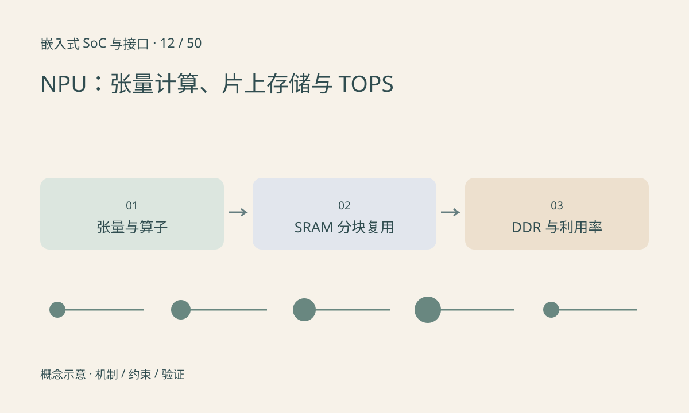

> 第 12 / 50 课 · 核心课程。返回[课程合集](/series/embedded-soc-interfaces/)。

## NPU 加速的是一组受支持的计算

NPU 通常面向神经网络张量运算，但不同产品的算子、数值格式、形状和编译限制差别很大。它不是另一个可以随意执行 Python 的 CPU。模型先被编译或转换成设备可执行计划，运行时再管理输入、输出和任务完成。

CPU 承担调度与不支持的处理，NPU 承担可映射的计算。图中途回退到 CPU 会增加同步、布局转换和数据搬运，算子数量占比很小的回退也可能成为瓶颈。

## 片上复用决定能否喂饱计算单元

矩阵和卷积会重复使用权重与输入。片上 SRAM 可以暂存分块数据，减少访问 DDR；但容量有限，切块方式会影响重复读取和中间结果写回。

可以用粗略下界分析：计算时间至少为工作量除以可用计算率，搬运时间至少为数据量除以有效带宽。若二者能够部分重叠，总时间仍不可能低于两者较大值；这不是精确调度模型。

## TOPS 必须带条件读

比较前确认精度、稀疏条件、乘加算一次还是两次、峰值还是实测。8 TOPS 不意味着每个模型都能获得每秒 8 万亿有效运算。batch、形状、内存和编译覆盖都会改变利用率。

模型实际转换和数值验证接[海思 NPU 系列](/series/hi3516-npu-conversion/)，本课先解释硬件为什么受这些条件限制。



## 练习与参考结论

构造 1 GOP 工作量、100 MB 搬运、1 TOPS 可用计算率和 5 GB/s 有效带宽。计算下界为 1ms，搬运下界为 20ms；仅提高计算峰值无法消除搬运限制。

单位全部使用十进制，并保持 OP 计数口径一致。代码输出的是假设条件下的下界，不是芯片跑分。

### 配套代码

下载包包含独立运行所需文件，使用 Python 标准库；这里验证机制和计算，不代表开发板测量结果。

```experiment
practice
```

## 延伸阅读

- [官方资料：NPU：张量计算、片上存储与 TOPS](https://www.arm.com/products/silicon-ip-cpu/ethos)

[上一课：DSP：滤波、FFT、定点数与饱和](/posts/soc-11-dsp-fixed-point.html) · [下一课：ISP：从传感器 RAW 到可用图像](/posts/soc-13-isp-pipeline.html)
