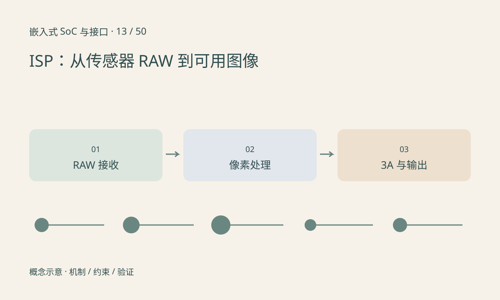

> 第 13 / 50 课 · 核心课程。返回[课程合集](/series/embedded-soc-interfaces/)。

## RAW 不是已经完成处理的 RGB

Bayer 传感器的单个采样位置通常对应一种滤色通道，需要结合邻域重建颜色。黑电平、坏点、镜头阴影、去噪、去马赛克、白平衡与色彩处理组成典型 ISP 功能，但具体顺序和硬件实现因平台而异。

CSI 接收负责接收和解析传输，ISP 负责图像处理，两者职责不同。有效接收到 RAW 不代表最终画面颜色正确；最终 RGB 看起来正常也不能证明 RAW 元数据和曝光时序都正确。

## 3A 是带反馈的控制

自动曝光、自动白平衡和自动对焦依赖统计量及执行器。控制设置可能在后续帧才生效，需要关联帧号和传感器应用延迟。频繁调整曝光会改变噪声、运动模糊和模型输入分布。

给模型做归一化不能替代 ISP。训练使用的图片处理链与实际摄像头链差异过大，可能造成推理下降，排查时应保存同一帧在不同阶段的输出。

## 练习与参考结论

给一张保存帧填写：RAW 位深、Bayer 顺序、曝光、增益、ISP 输出格式、色域和帧号。区分“色偏来自 Bayer 顺序错误”和“白平衡参数变化”需要哪些证据？

参考路径：先确认接收尺寸、位深与排列，再检查 ISP 配置，最后观察 3A 动态。详细图像步骤见[ISP 基础](/series/isp-basics/)。没有原始帧时不要仅凭最终截图断定具体算法故障。

## 延伸阅读

- [官方资料：ISP：从传感器 RAW 到可用图像](https://www.raspberrypi.com/documentation/accessories/camera.html)

[上一课：NPU：张量计算、片上存储与 TOPS](/posts/soc-12-npu-architecture.html) · [下一课：视频编解码器与图像加速器](/posts/soc-14-codec-accelerators.html)
