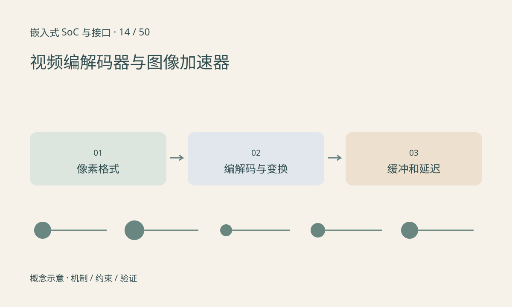

> 第 14 / 50 课 · 核心课程。返回[课程合集](/series/embedded-soc-interfaces/)。

## 三种输出不能混为一谈

视频编码器把图像序列压缩成码流，解码器从码流恢复像素；缩放或二维图像加速器进行裁剪、缩放、旋转、颜色转换等操作；NPU 执行受支持的神经网络计算。厂商的 VPU、G2D 等命名并不完全统一，应读功能说明。

编码输入常是某种 YUV 布局，并有 stride、地址和对齐要求。分辨率相同的 NV12 和 I420 内存排列不同。传错格式可能不会立即崩溃，却会产生颜色和条纹问题。

## 压缩率与延迟各有代价

码率不是原始像素带宽。参考帧、帧重排、缓冲和 GOP 设计会影响内存及延迟。某种配置画质更好，不意味着适合实时控制；低延迟目标需把编码、网络与解码显示一起测量。

专用加速器可能与 ISP 或显示共享缓冲，但必须确认格式和同步条件。若每帧都回 CPU 转一次格式，硬件编码快也可能仍然卡顿。

## 练习与参考结论

手算 1920×1080、30fps、NV12 的有效原始流量，再与构造的 4Mbit/s 压缩输出比较。解释为什么这两个值既不能直接代表 DDR 总带宽，也不能预测画质。

板端记录输入提交、编码完成和下游消费时间，检查是否有缓冲排队。编码 API 返回成功可能只表示任务进入队列，应按 SDK 的完成语义判断。

## 延伸阅读

- [官方资料：视频编解码器与图像加速器](https://docs.kernel.org/userspace-api/media/v4l/dev-encoder.html)

[上一课：ISP：从传感器 RAW 到可用图像](/posts/soc-13-isp-pipeline.html) · [下一课：Boot ROM、Bootloader 与系统启动](/posts/soc-15-boot-chain.html)
