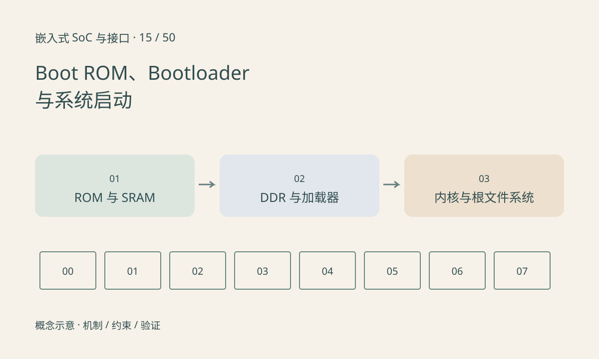

> 第 15 / 50 课 · 核心课程。返回[课程合集](/series/embedded-soc-interfaces/)。

## 第一段代码不来自根文件系统

复位后处理器从架构规定入口开始执行。SoC 的 Boot ROM 通常读取启动配置、访问支持的介质并加载下一阶段，但具体流程因芯片而异。Bootloader 可能分多级，较早阶段在片上 SRAM 运行，初始化 DDR 后再加载较大镜像。

内核启动之后仍需要设备树、驱动与根文件系统。根文件系统挂载失败与 ROM 未读到启动介质是两个很远的阶段，排查证据完全不同。

## 日志是一组阶段边界

没有 UART 输出可能是还没执行到串口初始化，也可能是时钟、引脚、波特率或日志关闭。不要把“无打印”直接等同于 CPU 没运行。结合电源、复位、启动 strap、介质访问波形和早期调试手段缩小范围。

启动参数与硬件初始化也可能继承自前一阶段。一个外设只在某个 bootloader 版本下能工作，提示需要检查内核驱动是否遗漏独立初始化，不能长期依赖偶然的残留配置。

## 练习与参考结论

制作启动时间线：复位释放、ROM 读取、早期加载器、DDR 就绪、完整 bootloader、内核入口、根文件系统、业务服务。每个节点写一个可观察证据。

构造“已看到内核版本，但等待 root device”的日志，应优先调查存储驱动、分区和 root 参数，而不是首先重写 ROM 启动配置。保留最早错误与前后上下文。

## 延伸阅读

- [官方资料：Boot ROM、Bootloader 与系统启动](https://docs.u-boot.org/en/latest/usage/spl_boot.html)

[上一课：视频编解码器与图像加速器](/posts/soc-14-codec-accelerators.html) · [下一课：NOR、NAND、擦写与 ECC](/posts/soc-16-flash-ecc.html)
