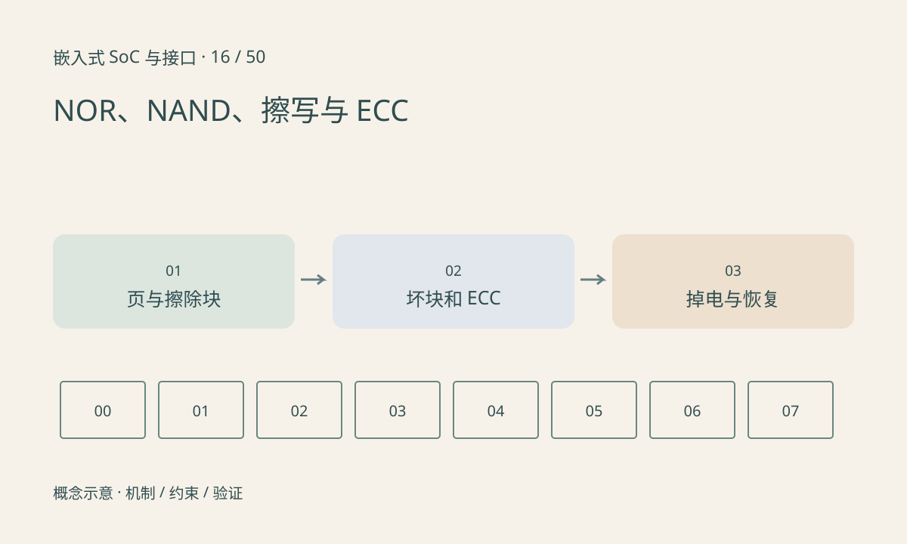

> 第 16 / 50 课 · 核心课程。返回[课程合集](/series/embedded-soc-interfaces/)。

## 写入不是任意字节覆盖

Flash 擦除和编程有不同粒度，通常不能像 RAM 一样随意把每一位来回改写。NOR 常用于启动和直接映射读取；NAND 常以页读写、块擦除，需要考虑坏块和纠错。具体粒度与限制由器件定义。

原始 NAND 的控制器、ECC、坏块管理和文件系统之间有职责边界。eMMC 等受管理设备把许多介质细节放到内部控制器，软件不能把两种设备的坏块策略直接互换。

## ECC 纠错不是数据永不损坏

ECC 能力有限，并依赖正确的布局、强度与读写参数。可纠正位数逐渐增加是值得观察的信号；不可纠正错误需要明确处理。CRC 用于检错，不提供任意纠错能力，也不提供固件真实性。

擦写寿命、保持时间和掉电行为相关但不同。只测连续读取速度无法评价升级可靠性。不要在生产介质上直接运行破坏性擦写实验。

## 练习与参考结论

纸上模拟一个 4KiB 擦除块中更新 16 字节：需要保存哪些未变数据？若中途掉电，旧副本和新副本各处于什么状态？

参考结论：读改擦写不是原子操作。应结合日志、冗余或事务机制恢复，并按原始 Flash 或受管理块设备选择不同方案。实验用文件模拟，不擦除实际分区。

## 延伸阅读

- [官方资料：NOR、NAND、擦写与 ECC](https://docs.kernel.org/driver-api/mtdnand.html)

[上一课：Boot ROM、Bootloader 与系统启动](/posts/soc-15-boot-chain.html) · [下一课：eMMC：总线模式、内部管理与分区](/posts/soc-17-emmc-storage.html)
