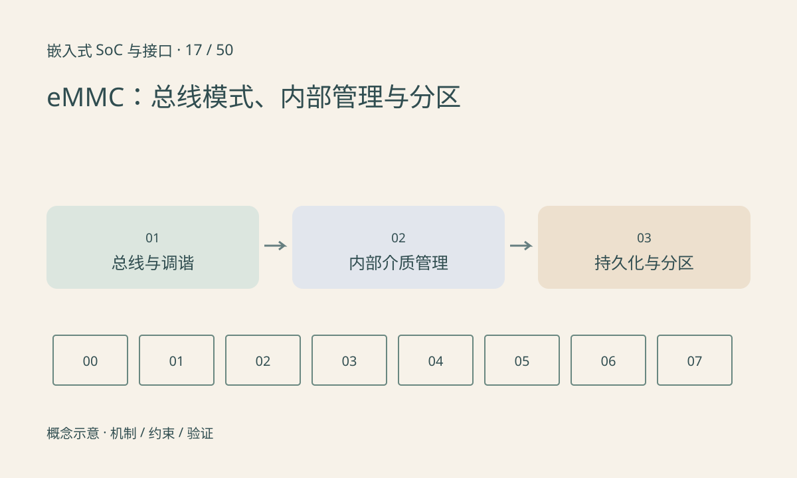

> 第 17 / 50 课 · 核心课程。返回[课程合集](/series/embedded-soc-interfaces/)。

## eMMC 不只是焊在板上的 SD 卡

eMMC 将存储介质和管理控制器封装在一起，有自身标准规定的总线、分区和管理机制。具体器件支持哪些高速模式、电压和调谐步骤，要同时核对主控、布线、驱动和器件能力。

主机看到逻辑块，不直接决定物理 NAND 页位置。内部擦除、搬移和缓存会让写延迟出现波动。标称顺序带宽不能保证每次小同步写都在同样时间内完成。

## 不同分区有不同用途

用户区、启动分区和 RPMB 等概念不能与普通文件系统分区混淆。RPMB 的认证访问机制也不等于自动加密所有用户数据。设备配置中的永久或一次性设置应按实际文档处理，本课不提供修改这类设置的命令。

写调用返回、文件系统提交和数据真正具备所需掉电持久性，是不同边界。需要配合文件系统、块层、设备缓存与可靠写能力定义升级事务。

## 练习与参考结论

记录一次业务写入的大小、同步要求、P50/P99 延迟和系统负载，不只记录 MB/s。若平均快而尾延迟大，检查内部维护、并发 I/O 和同步点。

只读识别设备型号和当前模式后，与手册核对；实际压力与掉电测试应使用专用测试介质及可恢复数据。不要将 RAM 文件复制结果写成 eMMC 实测。

## 延伸阅读

- [官方资料：eMMC：总线模式、内部管理与分区](https://docs.kernel.org/driver-api/mmc/mmc-dev-parts.html)

[上一课：NOR、NAND、擦写与 ECC](/posts/soc-16-flash-ecc.html) · [下一课：安全启动、固件签名与 A/B 升级](/posts/soc-18-secure-update.html)
