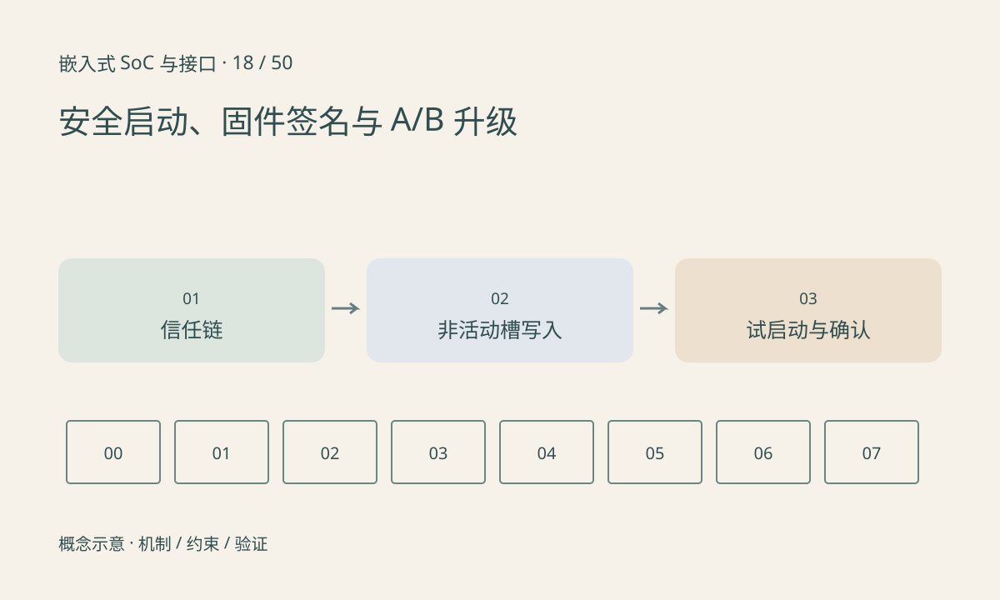

> 第 18 / 50 课 · 核心课程。返回[课程合集](/series/embedded-soc-interfaces/)。

## 校验和与可信来源不同

哈希可以发现内容变化，但若攻击者同时替换镜像和哈希，单独比较哈希不能判断来源。数字签名需要可信公钥或信任根；安全启动把验证关系延伸到后续执行组件。

签名有效不保证版本足够新。防回滚需要独立的版本策略和可靠保存的状态；也不能把任意修改版本号当作可信版本证明。哪些镜像、配置和设备树被保护，应明确列入验证范围。

## A/B 解决恢复，不自动解决信任

将新镜像写到非活动槽，完整验证后标记待试启动；启动成功并通过业务健康检查才确认。失败次数超过策略后回到已知可用槽。下载完整、写入完成、镜像可信和业务可用是不同阶段。

升级元数据自身也需抗掉电设计。若先切换活动标志再写镜像，掉电会指向不完整槽；若过早提高不可回退版本，又可能阻断回退恢复路径。



## 练习与参考结论

画出下载、写入、校验、试启动、确认五个状态，在每个边界假设掉电并写出下次启动选择。不要使用“应该不会断电”作为状态转移条件。

签名实验与交付流程接[固件签名升级系列](/series/firmware-signing/)。本课代码只模拟槽状态机，不是密码实现，也不写实际启动分区。

### 配套代码

下载包包含独立运行所需文件，使用 Python 标准库；这里验证机制和计算，不代表开发板测量结果。

```experiment
practice
```

## 延伸阅读

- [官方资料：安全启动、固件签名与 A/B 升级](https://docs.u-boot-project.org/en/latest/usage/fit/verified-boot.html)

[上一课：eMMC：总线模式、内部管理与分区](/posts/soc-17-emmc-storage.html) · [下一课：寄存器、地址空间与 MMIO](/posts/soc-19-mmio-registers.html)
