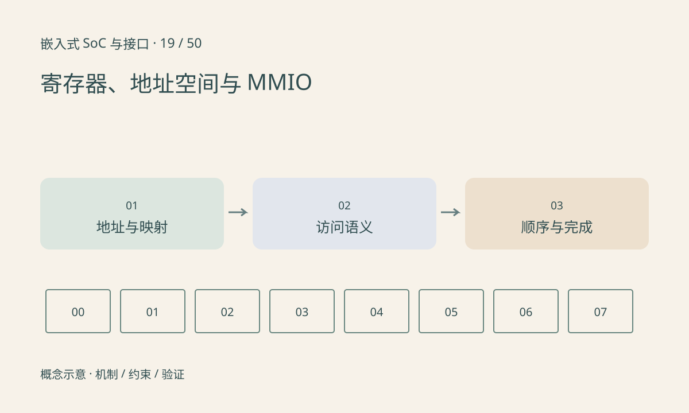

> 第 19 / 50 课 · 核心课程。返回[课程合集](/series/embedded-soc-interfaces/)。

## 相同的读写语法可能有不同副作用

寄存器可能只读、只写、写 1 清零、读后清零或带自清位。对写 1 清零状态寄存器做普通读改写，可能意外清除其他已置位事件。读取 FIFO 数据寄存器可能消费一项数据，不适合随意循环查看。

地址、访问宽度、字节序和对齐必须按手册。32 位寄存器不一定允许分成四次 8 位访问。Linux 驱动使用资源映射和 readl/writel 等接口，而不是把一个物理数值强转成普通指针。

## volatile 不能解决所有顺序问题

volatile 限制某些编译器优化，但不是多核锁、DMA 同步或完整设备屏障。写寄存器可能经过总线缓冲；需要确认提交与完成的区别，必要的读回或屏障按平台与设备规定使用。

用户态直接访问 `/dev/mem` 会绕开驱动资源管理，不能作为日常排障的默认手段。本系列使用离线寄存器模型说明语义，不修改真实硬件地址。



## 练习与参考结论

构造状态值 0b101，两个置位位都按 W1C 规则工作。只清除 bit0 应写 0b001，结果保留 0b100；若将读值原样写回则两位都清除。

先给实际寄存器表标注访问语义，再设计修改函数。保留位应按手册规则处理，不能统一理解为“写零总安全”。

### 配套代码

下载包包含独立运行所需文件，使用 Python 标准库；这里验证机制和计算，不代表开发板测量结果。

```experiment
practice
```

## 延伸阅读

- [官方资料：寄存器、地址空间与 MMIO](https://docs.kernel.org/driver-api/device-io.html)

[上一课：安全启动、固件签名与 A/B 升级](/posts/soc-18-secure-update.html) · [下一课：SRAM、DDR、带宽与延迟](/posts/soc-20-memory-bandwidth.html)
