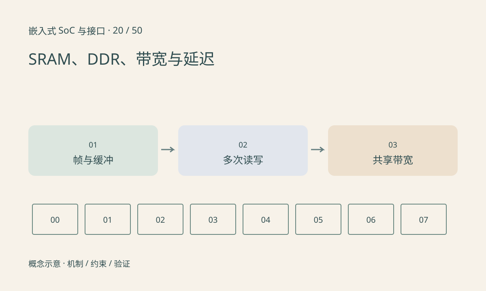

> 第 20 / 50 课 · 核心课程。返回[课程合集](/series/embedded-soc-interfaces/)。

## 容量、延迟和吞吐是不同维度

SRAM 常用于低延迟片上存储，DDR 提供较大容量，但访问受到控制器、行状态、读写切换与竞争影响。一个大块顺序传输的 GB/s 不能直接预测随机小访问的等待时间。

缓冲尺寸应包含 stride、平面、对齐和保留帧数。图像的有效像素字节数是起点，不是实际分配大小。三重缓冲可以缓解生产消费不同步，也增加占用并可能增加排队延迟。

## 为每一次读写记账

一帧被 ISP 写入、CPU 读出再写成 RGB、NPU 再读取，可能产生多次完整传输。一次 CPU memcpy 本身通常至少涉及源读和目标写。真正流量还受缓存、写分配、压缩和硬件内部通路影响。

多模块各自单测都快，同时启用却下降，可能是共享 DDR 或互连竞争。此时降低重复搬运、调整布局或流水线，可能比单纯增加计算频率更有效。



## 练习与参考结论

代码以 NV12 和 RGB888 为例计算有效帧大小，以及假设每秒 30 帧、多次读写时的流量。明确结果使用十进制 MB/s。

板端给每段画读写箭头，结合平台计数器或测量验证。对齐、缓存与 QoS 未建模的算术结果只能用作预算，不是实际性能保证。

### 配套代码

下载包包含独立运行所需文件，使用 Python 标准库；这里验证机制和计算，不代表开发板测量结果。

```experiment
practice
```

## 延伸阅读

- [官方资料：SRAM、DDR、带宽与延迟](https://www.arm.com/architecture/system-architectures/amba/amba-specifications)

[上一课：寄存器、地址空间与 MMIO](/posts/soc-19-mmio-registers.html) · [下一课：Cache、一致性与可见性](/posts/soc-21-cache-coherence.html)
