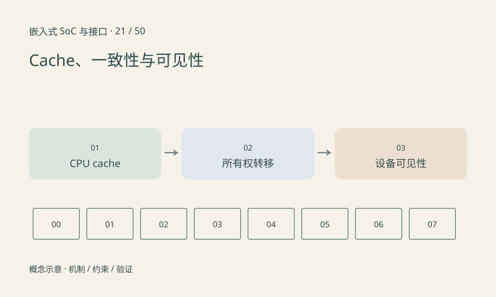

> 第 21 / 50 课 · 核心课程。返回[课程合集](/series/embedded-soc-interfaces/)。

## CPU 看见的新值不一定已被设备看见

CPU 可以在 cache 中修改数据，而 DDR 中仍保留旧副本。非一致性设备读取内存时未必自动观察到 CPU 最新修改；反过来设备写入后，CPU 也可能继续使用旧缓存行。

多核硬件缓存一致性与 CPU—设备一致性不是同一个承诺。即使平台声明 coherent，也仍需要遵守提交顺序与缓冲所有权，不能让生产者修改消费者正在读取的内容。

## 同步动作必须匹配方向与阶段

Linux DMA API 按平台处理映射与同步，驱动应使用正确方向，并在 CPU 和设备之间转交所有权。不要手写一段通用 cache flush 就认为适用于所有体系结构。

cache line 往往比业务字段大。两个独立对象共享一行时，清理或失效操作可能影响相邻对象；对齐约束与共享粒度需要考虑。多核中的 false sharing 还可能让本来无关的频繁更新互相干扰。

## 可见不等于有序

“看到完成标志”应保证对应数据也已按协议发布。release/acquire、设备屏障和 DMA 同步各自作用于不同边界，不能互相代替。先画状态转换，才知道哪一方可以在何时访问哪块数据。



## 练习与参考结论

离线模型设置 CPU cache=新值、内存=旧值，观察设备读取结果；再模拟归还给 CPU 前的同步。模型不模拟真实 cache 指令，只揭示两份副本与所有权。

参考检查：提交后 CPU 不继续改输入，完成后设备不继续写已交给 CPU 的输出，缓冲再次提交前所有消费者都已释放。

### 配套代码

下载包包含独立运行所需文件，使用 Python 标准库；这里验证机制和计算，不代表开发板测量结果。

```experiment
practice
```

## 延伸阅读

- [官方资料：Cache、一致性与可见性](https://docs.kernel.org/core-api/dma-api.html)

[上一课：SRAM、DDR、带宽与延迟](/posts/soc-20-memory-bandwidth.html) · [下一课：DMA、描述符与环形缓冲](/posts/soc-22-dma-rings.html)
