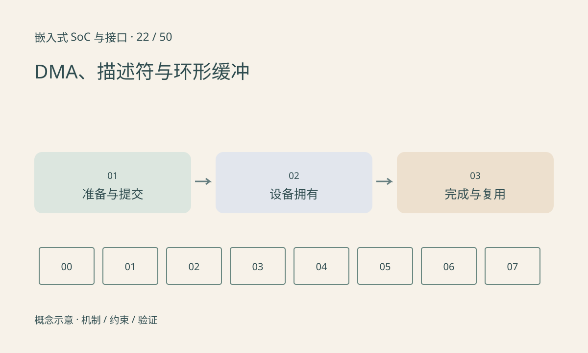

> 第 22 / 50 课 · 核心课程。返回[课程合集](/series/embedded-soc-interfaces/)。

## DMA 替代逐字节搬运，不替代管理

CPU 配置源、目的、长度或描述符，DMA 引擎执行传输。描述符可能还包含链表指针、所有权位和状态。具体格式由硬件规定，不能把普通数组地址直接写入所有设备。

提交成功只表示设备可以开始处理，完成通知才允许依协议使用结果。中断合并可能一次通知多个完成项，也可能丢失边沿后需要查询队列；驱动必须依据硬件完成状态消费，而不是假设“一次中断恰好一帧”。

## 环形缓冲最重要的是不覆盖在用项

每项可以经过 FREE→DEVICE→CPU→FREE。环回后索引相同，不代表这是同一代数据；可用计数、序列号或 generation 区分。生产速度超过消费速度时要定义丢弃、背压或停止策略。

描述符和负载的可见性也需要管理。先发布指针再写数据可能让设备读到未准备好的内容；完成后过早解除映射也可能造成设备继续访问无效地址。



## 练习与参考结论

代码模拟三个槽和两轮提交，故意尝试复用 DEVICE 状态槽并拒绝。随后完成、消费、归还再提交。

移到真实板卡时检查 DMA 地址宽度、长度限制、对齐、边界与映射错误处理。离线状态机通过不证明设备可以 DMA 到任意内存。

### 配套代码

下载包包含独立运行所需文件，使用 Python 标准库；这里验证机制和计算，不代表开发板测量结果。

```experiment
practice
```

## 延伸阅读

- [官方资料：DMA、描述符与环形缓冲](https://docs.kernel.org/driver-api/dmaengine/client.html)

[上一课：Cache、一致性与可见性](/posts/soc-21-cache-coherence.html) · [下一课：MMU、IOMMU 与三种地址](/posts/soc-23-mmu-iommu.html)
