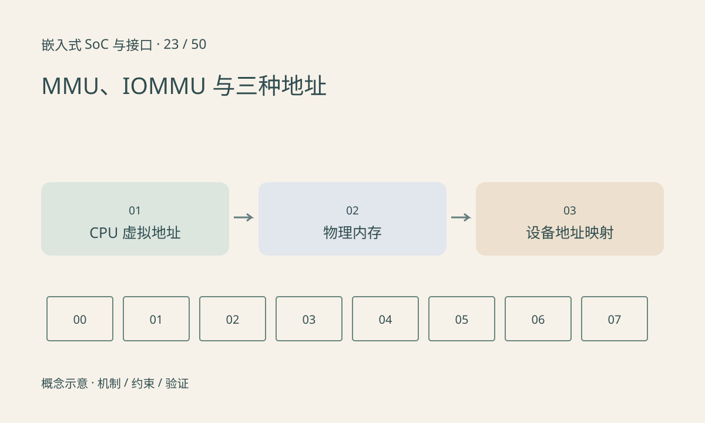

> 第 23 / 50 课 · 核心课程。返回[课程合集](/series/embedded-soc-interfaces/)。

## 地址数值相同也可能只是平台巧合

进程指针是 CPU 虚拟地址，经 MMU 页表映射到物理内存；设备使用的 DMA 地址还可能经过 IOMMU 映射。某个平台上 DMA 地址与物理地址相同，不代表驱动可以永远假设两者相同。

连续虚拟内存可能对应不连续物理页。Scatter-gather 可以描述多个片段，IOMMU 也可能提供连续设备地址视图，但具体设备与 API 能力需要核对。不能用“虚拟连续”替代 DMA 可访问性判断。

## 映射还有权限与生命周期

CPU 页表提供访问权限与内存属性，IOMMU 可约束设备访问范围。映射后仍需确保设备支持地址位宽，使用正确的数据方向，并在设备停止访问后解除映射。

TLB 缓存地址翻译，修改页表后如何使旧映射失效属于操作系统或平台机制。驱动应遵守提供的接口，不应在应用中随意操作页表来绕过映射失败。

## 练习与参考结论

画三列：进程虚拟地址、物理页、设备地址。让两段连续虚拟页映射到相隔很远的物理页，说明为什么设备不能仅凭第一个物理地址加长度覆盖全部数据。

交付时记录地址的类型而不只记录十六进制数。排查 fault 时首先确认它是 CPU page fault 还是设备 IOMMU fault，再查对应访问者和生命周期。

## 延伸阅读

- [官方资料：MMU、IOMMU 与三种地址](https://docs.kernel.org/core-api/dma-api-howto.html)

[上一课：DMA、描述符与环形缓冲](/posts/soc-22-dma-rings.html) · [下一课：AXI、AHB、APB 与片内互连](/posts/soc-24-amba-interconnect.html)
