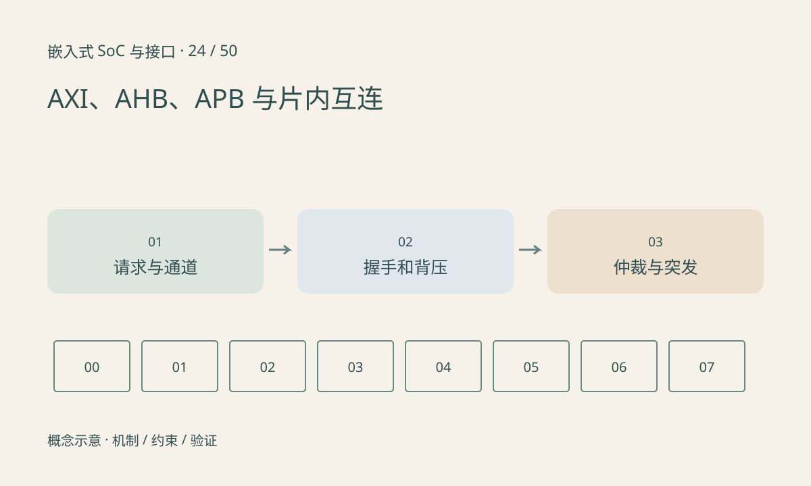

> 第 24 / 50 课 · 核心课程。返回[课程合集](/series/embedded-soc-interfaces/)。

## 不同协议服务不同复杂度的连接

AMBA 是协议家族，AXI 常用于高性能互连，AHB 常见于较简洁的系统连接，APB 常用于外设寄存器控制。具体版本与扩展不同，不应把所有 AXI、AHB 实现都视为相同能力。

AXI 的地址、数据与响应通道分离，允许更灵活的并发和流水；APB 采用较简单的访问阶段。寄存器访问的总线频率不能直接等于持续数据传输带宽，还要考虑等待、仲裁、响应和桥接。

## 握手要求双方共同满足

以 ready/valid 思路为例，只有两者同时有效的周期才完成一次传输。生产者声明有效但消费者施加背压时，必须按协议保留数据。把 valid 周期数当作完成数会高估吞吐。

突发可以摊薄地址开销，但有长度和边界约束。多个主设备争用同一 DDR 端口时，QoS 与仲裁策略会影响延迟，优先级也不等于任何负载下的绝对时限保证。



## 练习与参考结论

代码给出 valid 与 ready 序列，计算实际握手次数并输出停顿周期。假设 64 位数据总线、200MHz、每周期一拍，仅理论数据上限为 1.6GB/s，尚未扣除任何停顿。

分析一段硬件总线 trace 时，将请求、接受和响应分开。没有等待的微基准不代表多个加速器并发时仍有相同吞吐。

### 配套代码

下载包包含独立运行所需文件，使用 Python 标准库；这里验证机制和计算，不代表开发板测量结果。

```experiment
practice
```

## 延伸阅读

- [官方资料：AXI、AHB、APB 与片内互连](https://www.arm.com/architecture/system-architectures/amba/amba-specifications)

[上一课：MMU、IOMMU 与三种地址](/posts/soc-23-mmu-iommu.html) · [下一课：零拷贝、dma-buf 与缓冲生命周期](/posts/soc-25-zero-copy.html)
