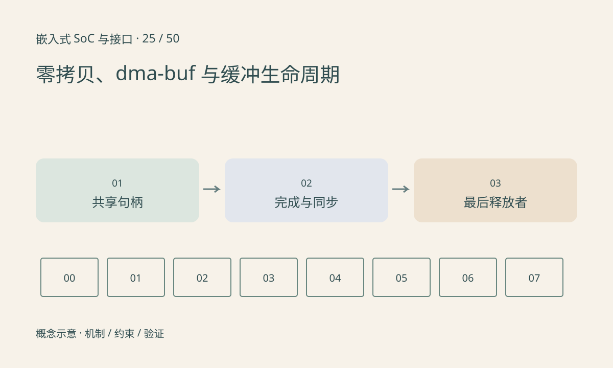

> 第 25 / 50 课 · 核心课程。返回[课程合集](/series/embedded-soc-interfaces/)。

## 共享对象不等于所有设备都能直接用

dma-buf 提供跨驱动共享缓冲的机制，用户态常用文件描述符传递引用。文件描述符不是 DMA 地址，导入方还需完成设备侧的附件、映射和访问管理。

同一缓冲的格式、stride、平面偏移、压缩或 tiling 必须被双方理解。若下游不能使用当前布局，仍可能需要转换或复制。只减少一次应用层 memcpy 不代表整条链路没有拷贝。

## 同步与生命周期需要一起设计

生产者完成写入后消费者才能读取，最后一个消费者完成后生产者才能复用。fence 表达异步工作完成，但不应把完成通知与所有平台的 CPU cache 同步混为一谈。

摄像头、显示和 NPU 并行消费时，引用计数只解决对象活多久，业务所有权还决定谁能改内容。超时后直接归还缓冲，可能让仍在执行的设备写坏下一帧。

## 练习与参考结论

画一个采集缓冲被编码和推理同时引用的时序图。编码先完成、推理未完成时是否可以重新交给摄像头？答案取决于协议，但不能仅凭一个消费者完成就复用。

交付一张缓冲表：分配者、导入者、格式、同步事件、取消策略和最后释放者。对照真实 SDK 判断哪些段仍发生颜色转换或复制。

## 延伸阅读

- [官方资料：零拷贝、dma-buf 与缓冲生命周期](https://docs.kernel.org/driver-api/dma-buf.html)

[上一课：AXI、AHB、APB 与片内互连](/posts/soc-24-amba-interconnect.html) · [下一课：共享内存、Mailbox 与核间通信](/posts/soc-26-heterogeneous-ipc.html)
