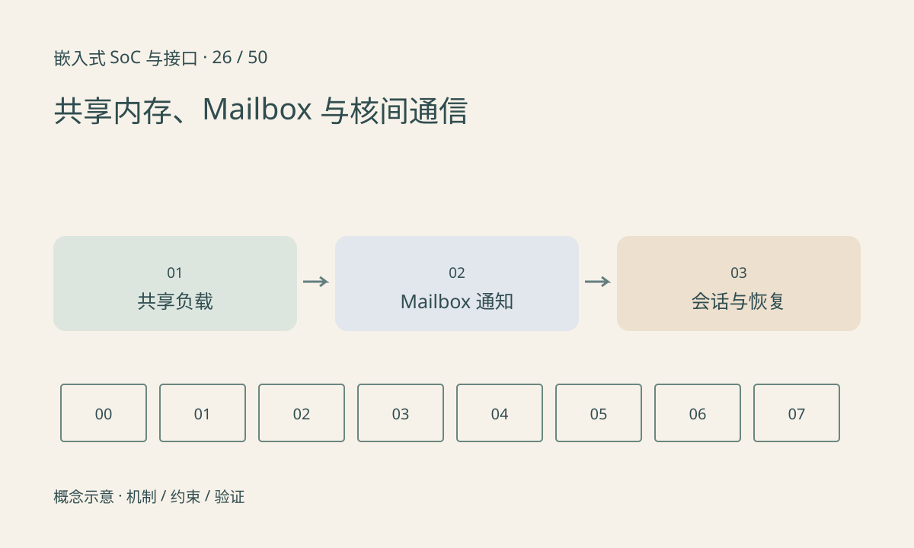

> 第 26 / 50 课 · 核心课程。返回[课程合集](/series/embedded-soc-interfaces/)。

## 通知与数据不是同一件事

Mailbox 常用于触发或传递少量通知，共享内存保存较大数据。收到 doorbell 不能自动证明负载已可见；发送方应先按协议发布数据，再通知接收方，接收方也要处理缓存与顺序。

Linux remoteproc 管理远端处理器的部分生命周期，rpmsg 提供基于 virtio 的消息机制；实际 SoC 是否采用这些框架取决于驱动和固件。它们不是所有核间通信的统一硬件协议。

## 协议需要考虑重启与版本

消息至少定义类型、长度、序列、版本和状态语义。共享内存不要直接放带本进程虚拟指针的 C 结构体，指针在另一个处理器上通常无意义。字节序、对齐和结构体填充也要明确。

远端重启后旧队列项可能仍存在，使用会话代号或 epoch 区分。请求超时不一定表示远端没执行，因此重试有副作用的命令时应有去重或幂等策略。

## 练习与参考结论

构造“开始一次采样”请求：发送端超时重发，接收端实际上已执行第一次。讨论如何用请求 ID 返回已有结果，而不是重复采样或重复驱动电机。

测试分别中断发送核和接收核，记录队列清理与会话重建规则。本文为协议设计练习，不加载远端固件、不重启实际处理核。

## 延伸阅读

- [官方资料：共享内存、Mailbox 与核间通信](https://docs.kernel.org/staging/rpmsg.html)

[上一课：零拷贝、dma-buf 与缓冲生命周期](/posts/soc-25-zero-copy.html) · [下一课：GPIO、Pinmux、上下拉与引脚状态](/posts/soc-27-gpio-pinmux.html)
