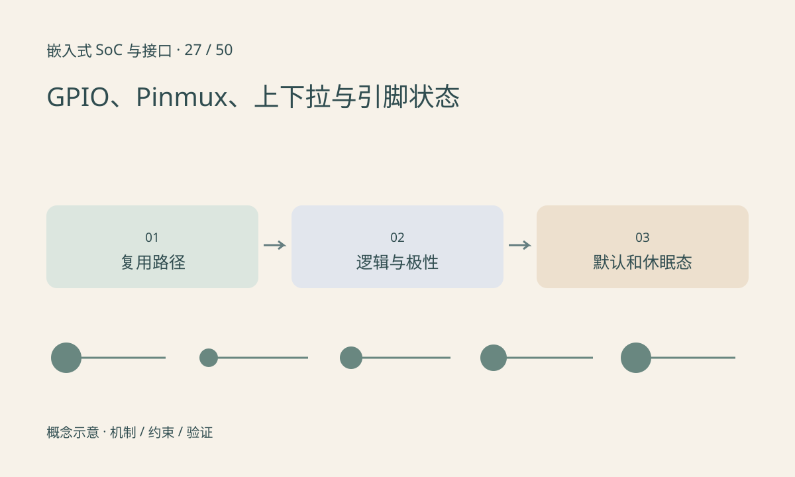

> 第 27 / 50 课 · 核心课程。返回[课程合集](/series/embedded-soc-interfaces/)。

## 一个引脚可能属于多个外设

Pinmux 决定引脚连接到 GPIO、UART、SPI 等哪条内部路径，pad 配置还可能控制驱动能力、上下拉、输入缓冲与其他电气属性。驱动能写 GPIO 寄存器，不代表引脚当前真的由 GPIO 控制。

有效低表示业务上的“启用”对应低电平。Linux 的描述符接口可根据描述把逻辑值转换为实际电平，若驱动再手工取反，可能出现双重反转。

## 上电与休眠状态也属于设计

输出默认态、输入浮空、boot strap 采样和外部上拉都可能决定启动行为。一个引脚在启动时作为模式选择，运行时再复用，不表示可以忽略启动期间的外部负载。

切换方向和复用可能产生短暂脉冲。对于 reset、power enable 或电机使能，瞬时变化也可能有影响，应检查平台能否先设输出值再切方向，以及具体驱动的实现。

## 练习与参考结论

为一个有效低 reset 脚填写运行、上电、休眠三种状态，分别写逻辑含义、实际电平、由谁驱动。用原理图核对上拉电源域。

参考排错顺序：资源归属→pinmux→方向→有效极性→pad 电气→外部负载。逻辑分析仪看到高电平，不能仅凭 API 参数判断它代表释放还是复位。

## 延伸阅读

- [官方资料：GPIO、Pinmux、上下拉与引脚状态](https://docs.kernel.org/driver-api/gpio/consumer.html)

[上一课：共享内存、Mailbox 与核间通信](/posts/soc-26-heterogeneous-ipc.html) · [下一课：UART、RS-232 与 RS-485](/posts/soc-28-uart-rs485.html)
