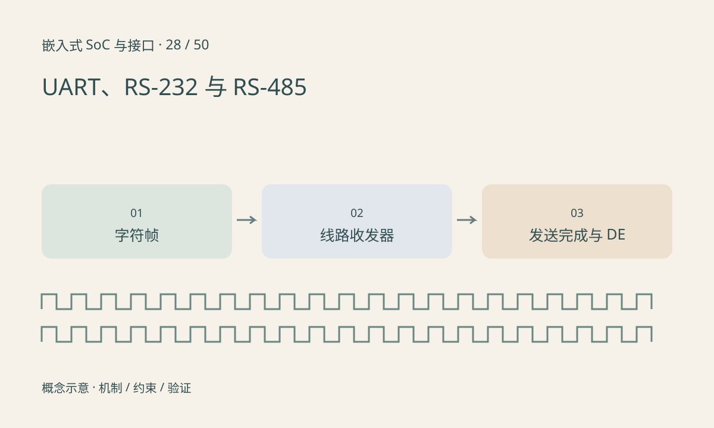

> 第 28 / 50 课 · 核心课程。返回[课程合集](/series/embedded-soc-interfaces/)。

## UART 定义的不是线路电压

UART 常把字节编码为起始位、数据位、可选校验和停止位。RS-232 与 RS-485 描述不同的电气接口，TTL/CMOS UART 引脚不能直接当作 RS-232 线路使用；RS-485 也需要相应收发器。

8N1 每个字节占十个比特时间，因此 115200 baud 的理想有效字节率约 11520B/s，不包括业务协议等待。波特率误差、帧格式和噪声都可能造成 framing error。

## 半双工方向要等真正发完

RS-485 常共享双向线对，需要控制发送使能。写入发送 FIFO 或 DMA 完成不一定表示移位寄存器的最后停止位已经出线。过早撤销 DE 会截断尾部，过晚释放则可能与对端回复冲突。

终端匹配放在线路拓扑要求的位置，偏置、共模范围、隔离与接地也需设计。不是每个节点都应随意并一个终端电阻。



## 练习与参考结论

计算发送 256 字节、115200、8N1 的理想线时长约 22.22ms。对照应用写调用耗时与引脚实际波形，解释为何二者不同。

构造尾字节丢失故障，优先比较 DE 下降与最后停止位，而不是只在上层不断加重试。测量前核对收发器侧与逻辑侧，避免把高电压线路直接接入普通分析仪。

### 配套代码

下载包包含独立运行所需文件，使用 Python 标准库；这里验证机制和计算，不代表开发板测量结果。

```experiment
practice
```

## 延伸阅读

- [官方资料：UART、RS-232 与 RS-485](https://docs.kernel.org/driver-api/serial/serial-rs485.html)

[上一课：GPIO、Pinmux、上下拉与引脚状态](/posts/soc-27-gpio-pinmux.html) · [下一课：I²C：地址、ACK、重复起始与上拉](/posts/soc-29-i2c.html)
