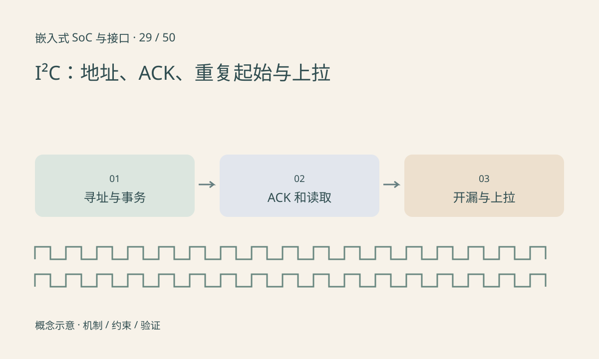

> 第 29 / 50 课 · 核心课程。返回[课程合集](/series/embedded-soc-interfaces/)。

## 地址与事务边界先说明白

常见 7 位地址不包含读写位，线上地址字节是地址左移一位再加 R/W。某些资料给出已移位的读写字节，把它再次左移会访问错误目标。还存在其他寻址模式，不能据此推断所有 I²C 都只支持 7 位地址。

典型寄存器读取可能是写寄存器索引→重复起始→读数据，但具体索引长度和事务要求由器件决定。重复起始不是任意 stop+start 的完全替代描述，某些设备依赖事务连续性。

## ACK 只能证明有限的事情

目标响应地址不表示寄存器配置正确，也不证明视频或采样链路正常。读最后一个字节时控制器通常发送 NACK 结束读取，不能把所有 NACK 都当故障。

开漏总线的上升沿依赖上拉与电容。电阻过大上升慢，过小增加低电平灌电流。总线恢复需确认哪一方拉低及控制器、器件规定，不应对未知设备随意扫描或强制发脉冲。



## 练习与参考结论

代码按构造地址 0x36 得到写字节 0x6C、读字节 0x6D，并估算 RC 上升时间。这个地址只用于教学。

纸上解码 START、地址、ACK、寄存器索引、重复 START、数据、NACK、STOP。真实板上先使用已知合法读取，再分析波形；不把盲目全地址扫描作为无副作用操作。

### 配套代码

下载包包含独立运行所需文件，使用 Python 标准库；这里验证机制和计算，不代表开发板测量结果。

```experiment
practice
```

## 延伸阅读

- [官方资料：I²C：地址、ACK、重复起始与上拉](https://www.nxp.com/docs/en/user-guide/UM10204.pdf)

[上一课：UART、RS-232 与 RS-485](/posts/soc-28-uart-rs485.html) · [下一课：SPI、QSPI 与 Flash 访问](/posts/soc-30-spi-qspi.html)
