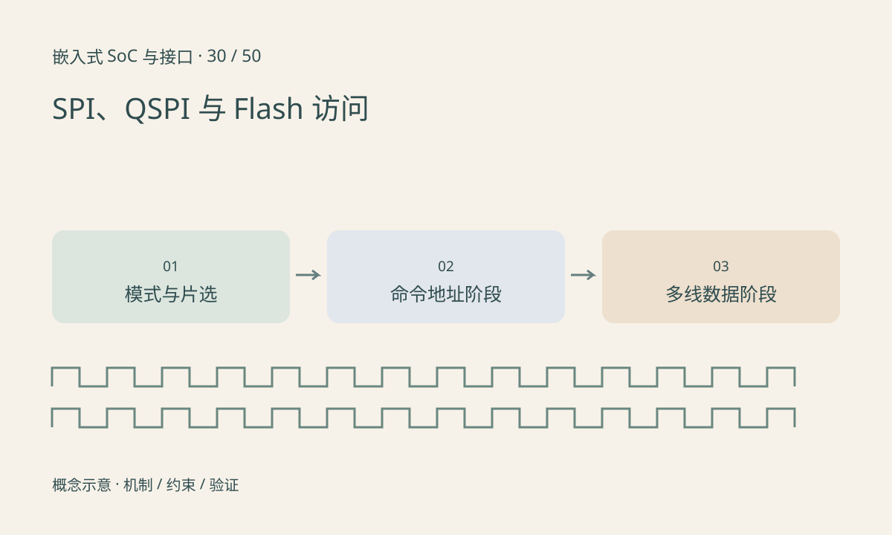

> 第 30 / 50 课 · 核心课程。返回[课程合集](/series/embedded-soc-interfaces/)。

## SPI 没有统一的寄存器命令格式

控制器提供时钟、数据和片选，外设规定命令、地址、dummy cycle 与返回数据。CPOL 定义空闲电平，CPHA 影响在哪个边沿采样；还要核对位序、字长和片选保持时间。

发送 dummy 字节常用于产生读取时钟，它不是一定要写进外设的业务数据。片选在命令与返回之间意外抬高，可能使设备重新开始解释命令。

## 多线模式分阶段定义

QSPI 常指四数据线能力，但某次事务可能是 1-1-4、1-4-4 等组合，分别表示命令、地址、数据阶段的线数。控制器与 Flash 需一致配置，进入某种模式还可能需要器件状态位或专用命令。

时钟提高后读错，可能来自采样延迟、dummy 配置、电气质量或工作电压，而不是笼统的“SPI 不稳定”。写 Flash 还要遵守写使能、忙状态、页边界与擦除规则。



## 练习与参考结论

手算 8 位命令、24 位地址、8 个 dummy 时钟和 256 字节数据，在单线 SDR 与仅数据四线 SDR 下分别占多少时钟。答案为 2088 与 552；不包含片选间隔。

用逻辑分析仪比较实际片选和边沿，先降低到器件支持的保守模式建立参考，再按手册调整。不要在未知 Flash 内容上试写命令验证接口。

### 配套代码

下载包包含独立运行所需文件，使用 Python 标准库；这里验证机制和计算，不代表开发板测量结果。

```experiment
practice
```

## 延伸阅读

- [官方资料：SPI、QSPI 与 Flash 访问](https://docs.kernel.org/driver-api/spi.html)

[上一课：I²C：地址、ACK、重复起始与上拉](/posts/soc-29-i2c.html) · [下一课：定时器、PWM、输入捕获与编码器](/posts/soc-31-timers-pwm.html)
