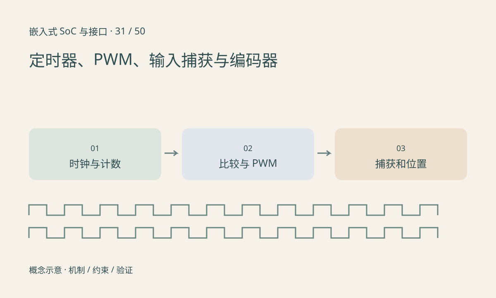

> 第 31 / 50 课 · 核心课程。返回[课程合集](/series/embedded-soc-interfaces/)。

## 定时器频率从实际输入时钟计算

在一种常见向上计数模型中，周期频率为 `timer_clock/((PSC+1)×(ARR+1))`。具体计数模式、时钟倍频、中心对齐和更新时机由芯片规定，不能只看到 APB 频率就直接代入。

PWM 占空比由比较和计数规则决定，极性与零/满占空比边界也要确认。软件 sleep 周期性翻 GPIO 会受调度抖动影响，不等价于硬件 PWM。

## 捕获与编码器提供反馈

输入捕获在边沿锁存计数值，两个捕获值的差给出周期。计数器回绕需要模运算，若跨越多个回绕周期还要额外计数或限定测量范围。输入滤波可抑制毛刺，也可能引入延迟或漏掉过快脉冲。

正交编码器利用 A/B 相位判断方向，x1/x2/x4 计数和机械每圈脉冲的定义需要统一。控制程序中的“步数”不自动等于实际位置，开环步进可能失步。



## 练习与参考结论

代码计算 72MHz、PSC=71、ARR=999 的 1kHz 周期，并处理 16 位捕获值从 65530 到 10 的回绕差 16。

硬件实验记录目标频率、实测频率、占空比和负载变化，再接已有[云台系列](/series/hi3516-pan-tilt/)。电机接口要经过对应驱动器，GPIO 不能直接承担电机电流。

### 配套代码

下载包包含独立运行所需文件，使用 Python 标准库；这里验证机制和计算，不代表开发板测量结果。

```experiment
practice
```

## 延伸阅读

- [官方资料：定时器、PWM、输入捕获与编码器](https://docs.kernel.org/driver-api/pwm.html)

[上一课：SPI、QSPI 与 Flash 访问](/posts/soc-30-spi-qspi.html) · [下一课：I²S、PCM、TDM 与音频时钟](/posts/soc-32-audio-i2s.html)
