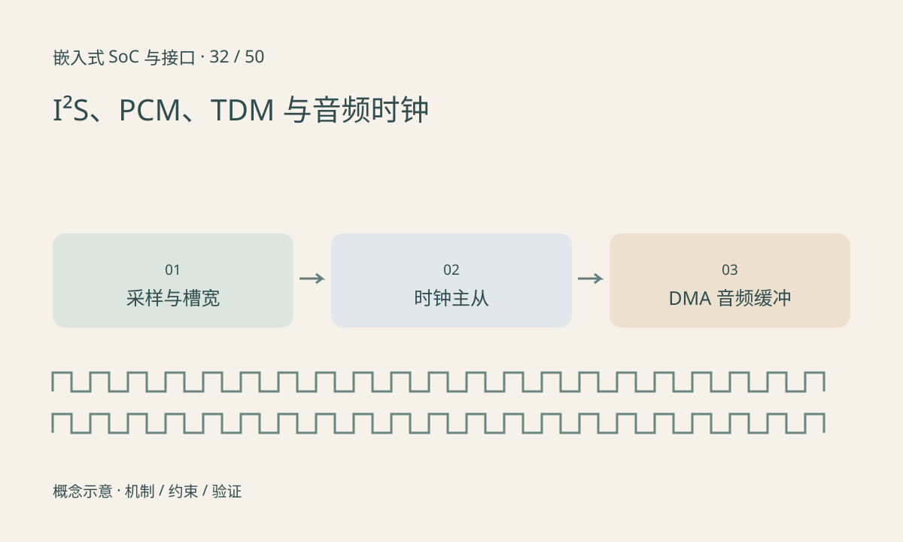

> 第 32 / 50 课 · 核心课程。返回[课程合集](/series/embedded-soc-interfaces/)。

## 有效位宽与槽宽可能不同

I²S 等串行音频接口通过位时钟和帧同步组织采样，某些器件还要求 MCLK。标准 I²S 的字选择变化与数据最高位之间有特定时序，不能把它与左对齐格式当成完全相同接口。

一个 24 位样本可能装在 32 位槽中，BCLK 按槽宽而不是有效位数计算。双通道、48kHz、32 位槽的位时钟为 3.072MHz。TDM 扩展到更多槽，但哪个槽属于哪个通道仍需配置。

## 主从角色与时钟稳定性

明确由 SoC 还是 codec 提供 BCLK、帧同步与 MCLK。双方都驱动会冲突，双方都等待则无时钟。采样率、时钟比例、极性和格式错配可能表现为静音、速度异常、失真或声道互换。

DMA period 和环形缓冲控制软件处理节奏。缓冲太短容易 underrun/overrun，太长增加延迟。音频时钟与系统时钟的微小漂移还会让长时间跨设备同步逐渐偏移。



## 练习与参考结论

计算 8 槽、每槽 32 位、48kHz 的 BCLK 为 12.288MHz。只使用其中两槽不一定降低线上的时钟需求。

用构造的交替左右声道数值检查槽映射，板端用合法测试音观察采样率和欠载计数。不要将放大器使能、模拟静音和数字接口无数据混成一种故障。

### 配套代码

下载包包含独立运行所需文件，使用 Python 标准库；这里验证机制和计算，不代表开发板测量结果。

```experiment
practice
```

## 延伸阅读

- [官方资料：I²S、PCM、TDM 与音频时钟](https://docs.kernel.org/sound/soc/overview.html)

[上一课：定时器、PWM、输入捕获与编码器](/posts/soc-31-timers-pwm.html) · [下一课：CAN 与 CAN FD：仲裁、帧和错误状态](/posts/soc-33-can-fd.html)
