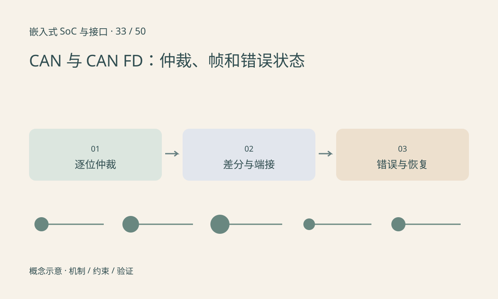

> 第 33 / 50 课 · 核心课程。返回[课程合集](/series/embedded-soc-interfaces/)。

## CAN 不是按节点地址轮流发送

CAN 标识符参与仲裁，并表达应用定义的消息含义；它不自动等于某个设备地址。在同类标识符格式与竞争条件下，逐位仲裁让显性位赢得对应竞争，不能简单理解为发送时发生冲突就整帧损坏。

CAN FD 在支持条件下扩展数据长度，并可在数据阶段使用不同速率；仲裁阶段与数据阶段的时序配置不同。网络所有参与者、收发器和控制器兼容性需要整体检查。

## 控制器之外还有物理网络

CAN 控制器需要收发器接入差分总线。拓扑、端接、支线长度、时钟误差和采样点都会影响可靠性。典型线形总线两端端接，不是在每个节点都并终端。

错误计数和 bus-off 是诊断证据。持续自动重启控制器可能掩盖布线或时序故障，应先记录错误状态再按策略恢复。SocketCAN 提供 Linux 接口，仍不替代上层消息周期和超时定义。

## 练习与参考结论

纸上比较两个相同格式的数据帧标识符 0x100 与 0x120 的首次差异位，解释仲裁胜负。再画双端端接，理想断电直流测量两个 120Ω 并联约为 60Ω，但实际读数还受电路影响。

离线整理一份消息表：ID、长度、字节序、周期、信号缩放和超时行为。虚拟 CAN 能验证软件路径，不能证明真实收发器和线路正常。

## 延伸阅读

- [官方资料：CAN 与 CAN FD：仲裁、帧和错误状态](https://docs.kernel.org/networking/can.html)

[上一课：I²S、PCM、TDM 与音频时钟](/posts/soc-32-audio-i2s.html) · [下一课：USB：角色、端点、传输类型与 UVC](/posts/soc-34-usb-uvc.html)
