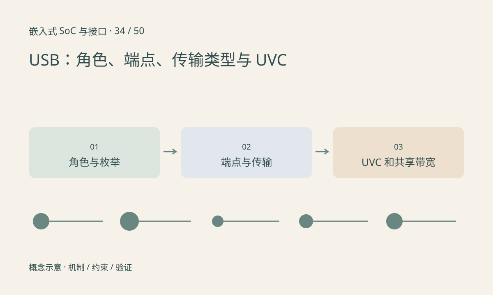

> 第 34 / 50 课 · 核心课程。返回[课程合集](/series/embedded-soc-interfaces/)。

## 插头形状不能告诉你全部能力

USB Host 管理总线，Device 提供功能，双角色控制器还需要正确的角色切换。Type-C 是连接器与相关连接体系的一部分，不保证每条线缆、端口都支持同样数据速率、功率或替代模式。

设备通过描述符说明接口和端点。端点不是一个 TCP 端口，control、bulk、interrupt、isochronous 具有不同调度和可靠性语义。USB 的 interrupt 传输也不是设备任意时刻直接打断主机。

## UVC 图像格式影响带宽

UVC 摄像头可能输出未压缩或压缩格式，实际支持组合看描述符和协商结果。1920×1080、30fps、16bit/像素的有效像素速率约为 995Mbit/s，已经超过 USB 2.0 高速的 480Mbit/s 原始线速，因此不能指望该未压缩组合通过增加缓冲实现。

这还没算协议开销。多个设备共享 hub 和上行链路时，更不能把每个下游接口标称速率分别相加当作可用总吞吐。



## 练习与参考结论

只读查看设备枚举速率、接口和可用视频格式，记录实际协商结果。设备能枚举但无法开流时，检查格式、带宽、供电及驱动状态，而不是重复拔插作为唯一手段。

将压缩视频加入分析时，需要单独计入解码耗时；降低 USB 带宽不一定降低 CPU 或总延迟。

### 配套代码

下载包包含独立运行所需文件，使用 Python 标准库；这里验证机制和计算，不代表开发板测量结果。

```experiment
practice
```

## 延伸阅读

- [官方资料：USB：角色、端点、传输类型与 UVC](https://docs.kernel.org/driver-api/usb/usb.html)

[上一课：CAN 与 CAN FD：仲裁、帧和错误状态](/posts/soc-33-can-fd.html) · [下一课：SD 与 SDIO：存储卡和外设功能](/posts/soc-35-sd-sdio.html)
