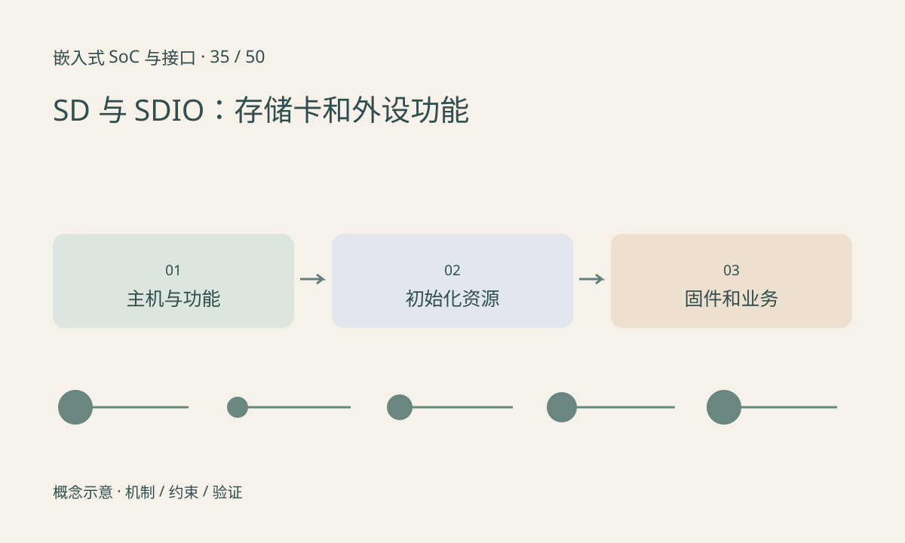

> 第 35 / 50 课 · 核心课程。返回[课程合集](/series/embedded-soc-interfaces/)。

## 同样的引脚不等于同样的软件对象

SD 存储卡主要提供存储功能，SDIO 面向 I/O 功能，也存在组合设备。无线模块可能通过 SDIO 接入，但不应把它当成普通磁盘挂载。主机控制器、设备类型和功能驱动需要分别识别。

总线宽度、频率、电压切换和支持模式应由双方能力决定。外设在上电后还可能需要复位、参考时钟、固件加载和独立唤醒信号，CMD/DAT 连线正确只是部分条件。

## 枚举、功能启动与业务通信分层验证

主机看到卡或功能，不代表 Wi-Fi 已关联，也不代表网络已能传数据。驱动 probe 成功之后，固件、校准数据和中断通路仍可能失败。

高速下间歇出错，需要结合信号质量、供电、时序调谐和休眠恢复分析。直接降低频率能帮助定位，但不能替代最终工作模式验证。

## 练习与参考结论

画一张 SDIO 无线模块资源表，除了 CLK/CMD/DAT，还列出供电、复位、低频参考、host wake 与设备树属性来源。

参考检查：把“未枚举”“已枚举但固件失败”“已启动但无法关联”“关联后吞吐低”分别归到不同证据层，避免只用 ping 结果判断总线硬件。

## 延伸阅读

- [官方资料：SD 与 SDIO：存储卡和外设功能](https://www.sdcard.org/developers/sd-standard-overview/)

[上一课：USB：角色、端点、传输类型与 UVC](/posts/soc-34-usb-uvc.html) · [下一课：Ethernet：MAC、PHY、MDIO 与吞吐](/posts/soc-36-ethernet.html)
