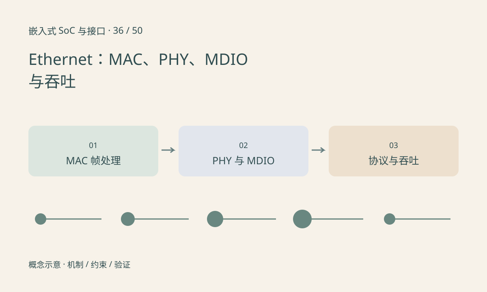

> 第 36 / 50 课 · 核心课程。返回[课程合集](/series/embedded-soc-interfaces/)。

## MAC 与 PHY 分工不同

MAC 处理以太网帧相关功能，PHY 处理物理链路及相应协商。二者可能集成，也可能通过 MII、RMII、RGMII 或其他接口连接。接口名称与时钟时序必须匹配，不能只因为都是以太网就任意连接。

MDIO 用于管理 PHY 寄存器，不承载正常业务数据。能读取 PHY ID 只证明管理通路部分工作，和 I²C 读到 sensor ID 的局限类似。

## 链路起来以后还有多层条件

Link up 不能证明 MAC 接口时序、DMA 描述符、IP 地址、路由或应用端口正确。RGMII 延迟配置若两边重复添加或都未添加，可能出现某些速率下偶发错误，具体需求由板级和器件设计决定。

标称线速还要扣除帧、间隔和上层协议开销。小包速率容易受每包处理成本限制，大包吞吐又可能受 DMA、内存与缓存约束。

## 练习与参考结论

构造“PHY link up、RX CRC 错误持续增长”的故障，先检查哪一段？应优先查看物理/MAC 接口与时序证据，而不是首先修改 HTTP 应用。

只读记录链路速率、双工、错误计数、收发包数和 CPU 负载，分别做同网段连通与应用测试。吞吐测试需要说明包大小、方向、协议和是否双向同时运行。

## 延伸阅读

- [官方资料：Ethernet：MAC、PHY、MDIO 与吞吐](https://docs.kernel.org/networking/phy.html)

[上一课：SD 与 SDIO：存储卡和外设功能](/posts/soc-35-sd-sdio.html) · [下一课：PCIe：链路、枚举、BAR、中断与 DMA](/posts/soc-37-pcie.html)
