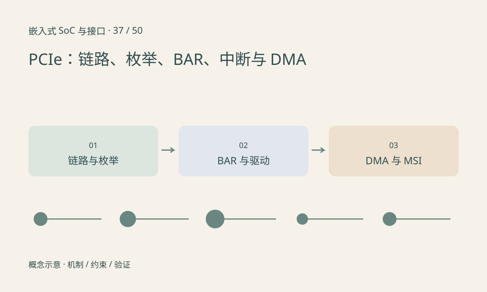

> 第 37 / 50 课 · 核心课程。返回[课程合集](/series/embedded-soc-interfaces/)。

## 链路训练先于驱动工作

Root Complex 与 Endpoint 建立链路，训练结果决定实际速率和 lane 数。插槽或芯片支持 x4，不表示当前链路必然以 x4 运行；参考时钟、复位、信号和对端能力都可能影响结果。

枚举为设备发现和分配资源。BAR 描述设备暴露的资源窗口，不是任意可用主机 RAM。驱动需要使能设备、申请资源、映射窗口，再按设备协议配置。

## DMA 和中断各自验证

Endpoint DMA 到主机缓冲需要有效 DMA 地址、映射和完成协议。MSI/MSI-X 是消息形式的中断机制，数量和路由取决于设备与平台。轮询正常而中断模式卡死，提示要分开检查完成状态与中断通路。

链路标称吞吐还需扣除编码和事务开销，读请求大小、完成延迟、并发请求和内存系统都会影响效果。BAR 读写成功不能证明持续 DMA 正确。

## 练习与参考结论

只读检查设备是否枚举、实际链路宽度/速率、BAR 和驱动绑定，再按设备官方示例验证一小块缓冲。不要对未知 BAR 偏移进行随意写入。

故障树分成“没链路”“有链路没枚举”“已枚举没驱动”“寄存器正常但 DMA 失败”“功能正常但性能低”，每层保存不同证据。

## 延伸阅读

- [官方资料：PCIe：链路、枚举、BAR、中断与 DMA](https://docs.kernel.org/PCI/pci.html)

[上一课：Ethernet：MAC、PHY、MDIO 与吞吐](/posts/soc-36-ethernet.html) · [下一课：MIPI 全景：CSI、DSI 与 PHY](/posts/soc-38-mipi-layers.html)
