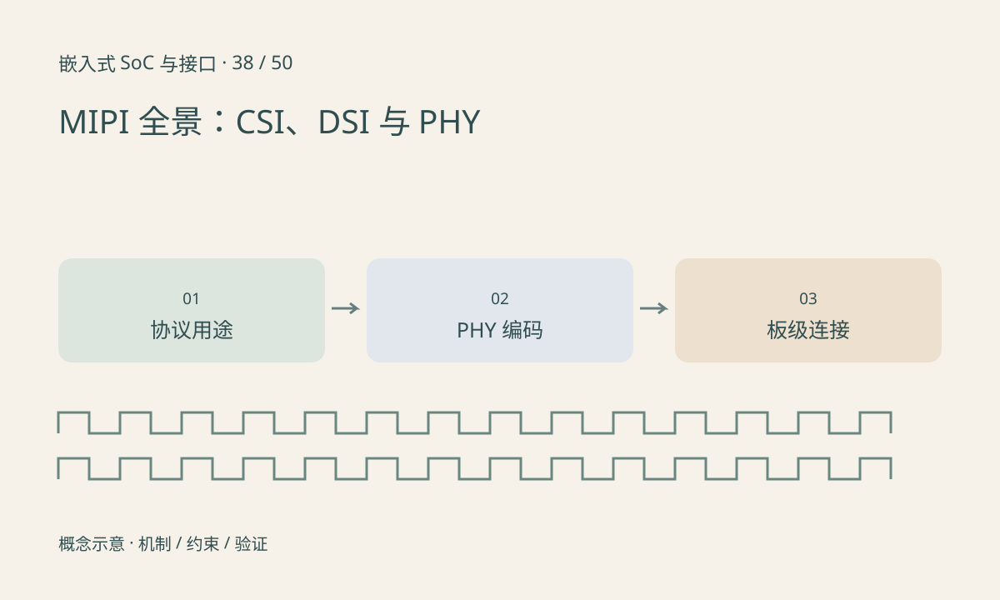

> 第 38 / 50 课 · 核心课程。返回[课程合集](/series/embedded-soc-interfaces/)。

## MIPI 是规范家族

CSI-2 常用于摄像头数据，DSI/DSI-2 面向显示，D-PHY、C-PHY、A-PHY 等描述不同物理传输机制。协议、物理层和连接器不是同一个层次。两端都写“MIPI”不表示可以直接相连。

摄像头控制还可能通过 I²C 类通路独立完成。数据 lane 负责像素流，不应把它们当作可随意复用的普通 GPIO。连接器 pinout、电压域和排线方向都由具体板级设计定义。

## lane 需要结合 PHY 解释

常见 D-PHY 实现以差分数据 lane 及相应时钟机制工作，C-PHY 使用不同的三线组编码方式，不能用同一个“每 lane 一位”的公式套用。不同版本还有能力变化，因此课程不会给出脱离版本的万能最大速率。

典型短距离板内连接与较长距离车载串行链路也不能混同。实际检查需列出协议版本、PHY 类型、通道数、速率、连接器与器件支持范围。

## 练习与参考结论

对一块摄像头板填写六项：CSI-2 版本依据、PHY、lane/线组配置、sensor 输出速率、接收端限制、板级 pinout。找不到的项目标为待查，不用营销页的“MIPI 支持”填满整张表。

区分三种不兼容：协议用途不同、物理层不同、连接器接线不同。更换排线不能解决前两种不兼容。

## 延伸阅读

- [官方资料：MIPI 全景：CSI、DSI 与 PHY](https://www.mipi.org/current-specifications)

[上一课：PCIe：链路、枚举、BAR、中断与 DMA](/posts/soc-37-pcie.html) · [下一课：摄像头接入：供电、复位、MCLK 与配置](/posts/soc-39-sensor-bringup.html)
