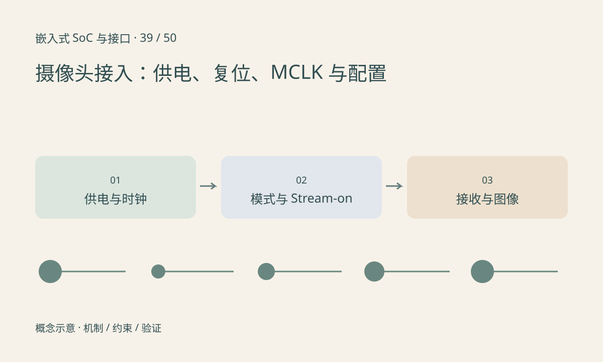

> 第 39 / 50 课 · 核心课程。返回[课程合集](/series/embedded-soc-interfaces/)。

## 先让器件处于允许被配置的状态

核对传感器模拟、数字、I/O 电源及其时序，确认 reset、power-down 等信号的有效极性和释放条件。MCLK 的频率、电平和稳定时间按器件要求设置，不应把其他型号的时序直接复制。

某些器件访问寄存器前就需要时钟，某些有不同要求。读到 ID 后，仍需匹配所选工作模式的 PLL、行场时序、位深、lane 数及 stream-on 配置。

## 控制、发送、接收逐层看证据

控制总线成功后，检查传感器是否进入输出状态；再检查接收端是否看到有效链路或包；随后检查帧尺寸、错误计数和图像格式。测试图模式若可用，能帮助区分光学曝光问题和数字链路问题，但仍需依器件文档使用。

Linux media graph 或厂商媒体管线中，上下游格式和连接关系也要一致。设置了某个 sensor mode，不代表接收器和 ISP 会自动同步全部参数。

## 练习与参考结论

用表格记录每步的前置条件、执行动作和观察证据，禁止只写“一键初始化成功”。构造故障：ID 正常、无帧计数，应继续检查 stream-on、时钟和 CSI 接收配置，不先修改神经网络代码。

实际板端先保存最原始可取得的数据与日志，再逐层增加 ISP、缩放和编码。这样能缩小首次出错的位置。

## 延伸阅读

- [官方资料：摄像头接入：供电、复位、MCLK 与配置](https://docs.kernel.org/driver-api/media/camera-sensor.html)

[上一课：MIPI 全景：CSI、DSI 与 PHY](/posts/soc-38-mipi-layers.html) · [下一课：CSI-2：数据类型、虚拟通道与带宽预算](/posts/soc-40-csi-bandwidth.html)
